# Graph controls catalogue

Read this before adding a control to a graph or lesson panel. Use an entry below; write a new control only when none fits, put it in `src/inputs/`, add it to the fixture (`fixtures/controls/main.tsx`) and add its entry here. Behaviour rules are in [shared graph controls](specs/shared-graph-controls.md), tokens in [DESIGN.md](../DESIGN.md#graph-controls), and the reasons for this file in [control choice and composition](specs/control-choice-and-composition.md).

## Which control

Start from the value the student changes, not from the widget.

| The value is | Use | Not |
| --- | --- | --- |
| A number in a range the student explores: parameter, coefficient, radius, time, weight, probability | `Slider` (it has an exact field for typing) | `NumberInput` |
| An angle in degrees | `AngleSlider` | `Slider` with hand-written wrapping |
| A count of things: points, terms, degree, steps, samples | `CountSetter` | `NumberInput`, `Slider` |
| A point drawn on the board | One row of `PointListInput`: name, `x`, `y` on one line | Two `NumberInput`s labelled "… x" and "… y" |
| Several points, with add and remove | `PointCollection` above a `PointListInput` | Per-graph add and remove buttons |
| A list of single numbers (zeros, nodes, samples) | `ValueListInput` | A column of `NumberInput`s |
| One of several named options, an example, a mode | `ChoiceSelect` | A row of buttons, a raw `<select>` |
| A board tool (Move, Add, Delete) | A named group of pressed buttons (`aria-pressed`) | `ChoiceSelect`: the active tool must stay visible on a projector |
| On or off, applied at once | `OnOffSwitch` (`BooleanField variant="switch"`) | A button that toggles |
| Several independent choices in one set | `CheckboxGroup` | Separate switches |
| A result hidden until asked | `RevealButton` | `OnOffSwitch` |
| A run through steps or time | `PlaybackButtons`, with a `Slider` for the position | Own Play, Pause and Reset buttons |
| A matrix, or a row of typed numbers (a knot vector) | `NumberGrid`: typed cells in the matrix's own rows and columns, or one wrapping row | Column vectors as point rows (that transposes the notation) |
| A number with no useful range | `NumberInput` | — |

Rules that the table implies:

- **`NumberInput` is not a default.** If the value has a `min`, a `max` and a `step`, it is a `Slider`. The slider shows the range, so help text that only states the range or the step goes.
- **One control per value.** Do not add a second control for something the panel or the host already offers: the host has Reset, Fit and Presets; a draggable point already has its typed row.
- **Say it once.** A sentence shown in a status line is not repeated in the readout list below it.
- **No local field helpers.** A `numberField()` method or an `IntField` component in a graph file is a sign that an entry here was missed. Call the shared control directly, or add a shared one.

## Layout in the inspector

The Orodja card and the panels in it are about 310 px wide on desktop (about 286 px of content; ADR 0063 replaced the fixed column with a board card) and the full width of a phone. Check a new panel at both.

- One value per line where it fits; a point is one line, never two.
- Fields in one group share their left and right edges.
- A label sits directly above or beside its control, never alone on a line of its own.
- Help under a control is at most two lines at 310 px.
- A control whose effect is hidden in the current state (the point or circle it edits is not shown) says so in a line directly under it, linked with `describedBy`, and the line goes when the object is shown.
- A reason shared by two fields side by side is shown once, full width, under the pair (`reasonShownElsewhere` with `describedBy`), not once per half-width field.
- A group box has all four edges; nothing is cut at the bottom of the panel.
- Look at a screenshot of the panel before calling it done. Measurements do not show a row that reads badly.

## Entries

| Control | Import | For | Notes |
| --- | --- | --- | --- |
| `Slider` | `src/inputs/Slider` | A ranged number | `customText` is its name. Exact field unless `formatValue` is set. `grid` snaps typed values with a notice; `cyclic` wraps; `unavailableReason` keeps it focusable; `hideBounds` drops the bounds, which otherwise sit as plain numbers at the two ends of the track (under it when both are long); `describedBy` adds ids to the range and the exact field. Arrow is one step, Shift or Page the `bigStep` |
| `AngleSlider` | `src/inputs/AngleSlider` | Degrees, 0 to 360, wrapping | Only the name, value and callbacks vary |
| `CountSetter` | `src/inputs/CountSetter` | An integer count | − value +. Buttons are unavailable with a reason at the bounds. `onSet` makes the value typeable |
| `NumberInput` | `src/inputs/NumberInput` | A typed number with no useful range; a grid cell | Commits on Enter or blur. Out of range is refused with a message, never clamped. `compact` and `hideLabel` are for cells inside another control |
| `PointListInput` | `src/inputs/PointListInput` | Typed coordinates of one or more points; the keyboard path for dragging | 1, 2 or 3 axes (`axisLabels`). `onRemove` adds a remove button per row; `onSelect` makes the name a pressed toggle. A single point is a list of one |
| `NumberGrid` | `src/inputs/NumberGrid` | Typed numbers laid out as a matrix or as one wrapping row (knot vector) | `label` (caption and group name), `columns` (a count or `"wrap"`), `cells` in row-major order (each the `NumberInput` props with its accessible `label`), `describedBy`, `help`. Cells are compact `NumberInput`s with no visible label of their own; refusal hints come under the cell's row |
| `PointCollection` | `src/inputs/PointCollection` | Count, add (button, typed entry, board mode), clear | Sits above its `PointListInput` |
| `ValueListInput` | `src/inputs/ValueListInput` | A list of single numbers | Same commit and refusal rules as the point list |
| `ChoiceSelect` | `src/inputs/ChoiceSelect` | One of several named options | Native select. A `custom` option appears only while the scene matches no example. A selected text that does not end before the arrow is also shown in full under the select; one that fits is not repeated |
| `ResetExampleButton` | `src/inputs/ResetExampleButton` | Back to the chosen example | Beside the example chooser; unavailable with a reason while the scene equals the example |
| `OnOffSwitch`, `BooleanField` | `src/inputs/OnOffSwitch`, `src/inputs/BooleanField` | On or off | Switch for immediate display toggles, checkbox within a set |
| `CheckboxGroup` | `src/inputs/CheckboxGroup` | Independent choices in one labelled set | |
| `RevealButton` | `src/inputs/RevealButton` | Show or hide a result | The label changes with the state |
| `UnavailableButton` | `src/inputs/UnavailableButton` | Any action that can be unavailable | Stays focusable (`aria-disabled`), states its reason on press. Never use native `disabled` |
| `PlaybackButtons` | `src/graphs/base/controls/PlaybackButtons` | Play, Pause, Step, Reset of a run | Shared labels and reduced-motion handling |
| `StepCounter` | `src/graphs/base/controls/StepCounter` | "Step n of m", counted from 1 | |
| `InspectorDisclosure` | `src/inputs/InspectorDisclosure` | A collapsible inspector group | Native `
`; open state survives tab switches |
| `ReadoutHeading`, `ReadoutList`, `ReadoutHelp`, `ReadoutScrollTable` | `src/graphs/base/controls/ReadoutParts` | Computed values shown as text | One list and heading style for every graph |
| `LiveReadout`, `StatusLive` | `src/graphs/base/controls/LiveReadout`, `StatusLive` | Screen-reader announcements of a changed state | One announcement per graph; silent while playing |
| `RefusalNotice` | `src/inputs/RefusalChannel` | Why an edit was refused | One channel per panel, shown alone, cleared by the next accepted edit |
| `ToolTippedButton` | `src/inputs/ToolTippedButton` | A button that needs a tooltip | |

The curve workspace's own panels (`CurveOperation`, `BezierCurveControls`, `CurveDisplayControls` and the rational and PH variants in `src/graphs/base/controls/`) are compositions of these for curve graphs; a new curve graph reuses them through `BaseCurveGraph`.

## Puck

A puck is a parameter control on the board, in the strip at the board's bottom-left, instead of in Orodja. Source: `src/workspace/pucks/` (`PuckStrip`, `ParameterPuck`, `RangePuck`, `CountPuck`, rules in `pucksModel.ts`); plan in [task 05](tasks/ux-picks-app-wide/05-pucks.md).

**When.** A `range` or `count` parameter of a declared graph (`graphDeclaration.ts`) becomes a puck when it is declared `placement: "board"` and bound in the graph's arbiter; the strip lists them in declared order. With `placement: "tools"` it stays a `Slider` (range) or `CountSetter` (count) in its Orodja `section`. A board parameter has no `section`. See the [placement rule](guides/converting-a-graph.md#3-placement-rule). A graph that is not declared has no pucks. One parameter has one control: a tools control wrapped in `PuckOwned` (`src/graphs/base/controls/PuckOwnership.tsx`) renders nothing while its parameter has a puck.

**Roles and names.** A range puck is `role="slider"`, a count puck `role="spinbutton"` (with named `−` and `+` buttons). The accessible name is the parameter's `label`, the same as its Orodja control would have; `aria-valuetext` carries the value and `unit`. Declared `help` shows as a tip on hover and focus and is linked with `aria-describedby`. Values are formatted in the app language, at a constant width.

**Keyboard** (focus the puck):

| Key | Range puck | Count puck |
| --- | --- | --- |
| Arrows | One `step` (Up and Right add) | One |
| Shift+Arrow, PageUp, PageDown | `bigStep` in value units; ten steps when `bigStep` is not declared | Not used |
| Home, End | `min`, `max` | `min`, `max` |
| Enter, double-click, or typing a digit, `-`, or (range only) `,` or `.` | Opens typed entry | Opens typed entry |

The mouse wheel also steps a range puck.

**Pointer (range puck).** Drag the puck sideways: the whole range spans a ruler of 120 to 360 px shown above it. Moving the pointer further above or below the puck makes the drag finer (a quarter, then a sixteenth, named on the ruler). A click on the track jumps there. A jump of more than one step, and a typed value more than one step away, offers an Undo pill. A count puck has buttons and keys only.

**Typed entry.** Enter commits, Escape cancels, leaving the field cancels. Either decimal convention is read. A number outside the range is refused with its reason (the allowed range), never clamped. A number off the step grid is snapped to the nearest grid point and the puck says "Zaokroženo na …" (`puck_snapped`). A count must be a whole number in range. A domain refusal from the graph's setter is shown at the puck.

**Not applicable means no puck.** A parameter that does not apply in the current state (the phase portrait's matrix entries on a nonlinear system, a composition slot's angle when the slot is a free matrix) is left out of the declaration: no puck, no Orodja control. Show a still-meaningful value as a readout (the Jacobian row). **Locked.** `locked: true` is only for a real lock with its own reason; it keeps the puck focusable and visible with `aria-disabled`; keys, drag and entry do nothing, and the reason (the default text, or the lesson frame's `lockReason`) is linked with `aria-describedby`. No declaration uses it today.

**During playback.** A graph that implements `PuckLiveValues` (`puckLiveValue(key)`) shows the live value of that key on its puck while it runs (De Casteljau's playing `t`); otherwise the puck shows the stored value. The `decasteljau-t` puck also carries Play and Reset (`PLAYBACK` in `PuckStrip.tsx`).

**Writes** go through the arbiter as `learner`, so a lesson lock and the domain checks apply as for any parameter.

**Toggle and choice kinds (task 05 slice 6).** Besides range and count, the strip holds switches and segmented choices. Rule: a choice or toggle is a puck when a lesson asks the learner to switch it and notice the change, or when exploration flips it repeatedly to compare two states; scene setup (example pickers, modes that rebuild the scene), rarely changed settings and display housekeeping stay in Orodja.
- **Toggle puck** (`TogglePuck`): a declared action with `puck: true`, `placement: "board"` and `pressed`. `role="switch"`, name = the action's `label`, `aria-checked` = `pressed`. A click anywhere on it, Space or Enter flips it.
- **Choice puck** (`ChoicePuck`): either a `choice` parameter with `puck: true` and `placement: "board"` (at most `MAX_CHOICE_PUCK_OPTIONS` = 4 options, else it stays in Orodja; `short` on an option is the segment text, the `label` stays its accessible name), or a group of 2 to 4 pressed actions that share `puck: {group: {key, label, help?}, short}` (Coons' shown surface). `role="radiogroup"` named by the label with `role="radio"` segments; Left/Up and Right/Down move and select (wrapping), Home and End jump.
- **Writes** are the learner's: a choice parameter through the arbiter, an action through `performAction`, the method its Orodja button calls. The old Orodja control is wrapped in `PuckOwned` with the parameter key, the action id, or a group's key and member ids, so one control carries the name.
- **Tests.** `puckControl(key)` also finds the switch or radiogroup; `puckOption(key, name)` returns one radio by accessible name. Component tests: `src/workspace/pucks/togglePucks.test.tsx`.

**Tests.** From `src/graphs/base/realGraphTestHarness.tsx`: `waitForPucks(key?)` waits for the laid-out strip, `puckControl(key)` returns the slider or spinbutton, `typePuck(key, text)` types and commits an entry, `openTools()` unfolds Orodja when a test needs it. Call `installBoardShims()` in `beforeAll` (its element sizes let the strip lay out), and a test that mounts a real graph mocks MathJax: `vi.mock('../../mathjax/loadMathJax', () => ({loadMathJax: () => Promise.resolve()}))` (path relative to the test file).

## Pictures

Each control at inspector width, in an ordinary state, from the controls fixture. `LiveReadout` and `StatusLive` have no visible part.

`Slider` 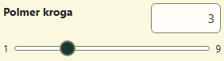

`AngleSlider` 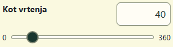

`CountSetter` 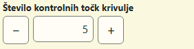

`NumberInput` 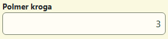

`PointListInput` 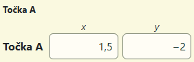

`NumberGrid` 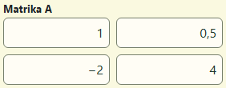

`PointCollection` 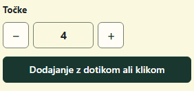

`ValueListInput` 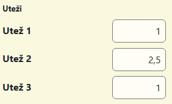

`ChoiceSelect` 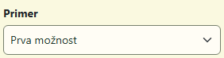

`ResetExampleButton` 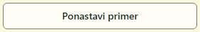

`OnOffSwitch` 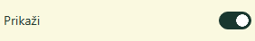

`BooleanField` 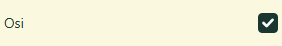

`CheckboxGroup` 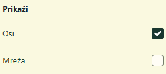

`RevealButton` 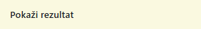

`UnavailableButton` 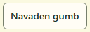

`PlaybackButtons` 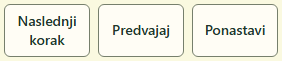

`StepCounter` 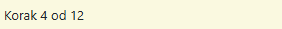

`InspectorDisclosure` 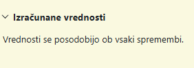

`ReadoutHeading` 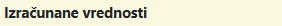

`ReadoutList` 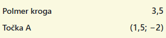

`ReadoutHelp` 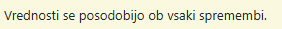

`ReadoutScrollTable` 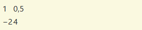

`RefusalNotice` 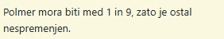

`ToolTippedButton` 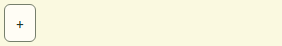

## Checking a panel

- `just controls-fixture` renders every shared control at inspector width, on a phone and at 200 % text, and fails on clipping, a missing focus ring, a small touch target or a point row that wraps.
- `node scripts/controls-inventory.cjs` regenerates the [call-site inventory](tasks/control-choice/inventory.md): every shared control in graph and lesson code, with a first reading of each typed number field against the table above.
- `node scripts/controls-sweep/catalogue-shots.cjs` regenerates the [pictures](#pictures) from the fixture (it starts its own dev server). A control with no `data-catalogue` entry in `fixtures/controls/main.tsx` has no catalogue entry.
