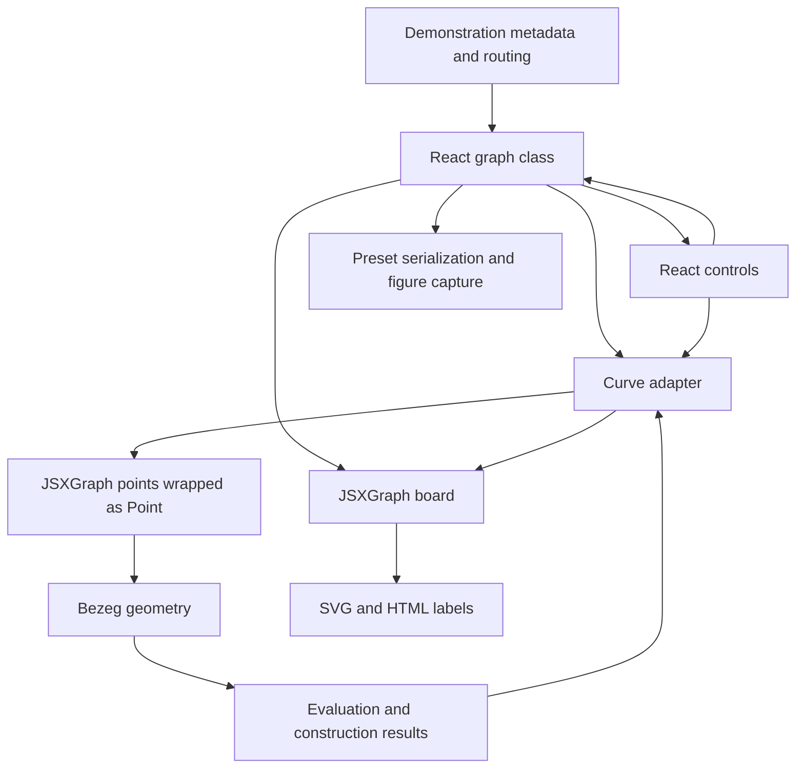

# Curve drawing and architecture deep dive

Source assessment: 2026-10-09. This examines the current working tree, including existing uncommitted workspace edits; it is not a frozen release audit. Recommendations below are proposals, not accepted migrations. No application code, dependency, route, or preset format is changed by this assessment.

Implementation follow-up: the owner authorized the first [curve ownership foundation](specs/curve-ownership-refactor.md). The diagnosis below records the pre-refactor data flow; use [current architecture](current-architecture.md) for the implemented numeric input bindings, graph-session lifecycle and figure-export boundaries. The wider scene/command/codec decomposition and renderer comparison remain future work.

## Recommendation

Keep the mathematical implementations and JSXGraph initially. First give geometry, scene state, rendering, controls, persistence, and export separate ownership. The largest maintainability problem is their coupling, rather than a demonstrated inability of JSXGraph to draw the required curves. Replacing JSXGraph today would require rebuilding substantial educational interaction behavior while carrying that coupling forward.

After a representative feature works through the new seam, compare JSXGraph with a small custom SVG adapter using the same geometry and scene fixtures. Consider Canvas only where measured drawing cost warrants it. Keep a build-tool migration separate. The detailed, first-party library comparison is in [renderer options](research/curve-renderer-options.md).

## What is already documented

The [capability map](capabilities.md) inventories all 26 active routes, route-specific controls, parameter ranges, dormant code, and caveats. [UI functionality](ui-functionality.md) describes selection, editing modes, view controls, presets, exports, and language selection. [Current architecture](current-architecture.md) covers the shell, hosting, lessons, and persistence. These remain the canonical inventories; this document adds the dependency analysis, drawing path, preservation requirements, and proposed decomposition that were missing.

Evidence here comes from repository source, existing tests, and previously recorded performance reports. No new interaction benchmark or physical-device audit was run. Runtime parity, numerical robustness, and replacement-renderer performance remain verification work.

## Functionalities a refactor must preserve

| Family | Mathematical and visual behavior | Interaction obligations |
| --- | --- | --- |
| Foundations | Bernstein bases of displayed degree 0–5; individual curves and stacked-area view | Degree changes, labels, viewport, presets and figure export |
| Polynomial Bézier | Arbitrary supported point counts, control polygon, convex hull, evaluation marker, complete De Casteljau construction, subdivision, repeated subdivision, shortening, extrapolation and elevation | Point edits, selected-curve transforms, previews, construction parameter, partial/full curve, animation and dedicated demonstration controls |
| Rational Bézier | Weighted evaluation/construction, homogeneous subdivision/extrapolation, weighted elevation, weight labels, standard-form display, Farin points and circle pieces | Weight selection/change/reset, constrained Farin editing, piece-count changes, and all applicable polynomial operations |
| Splines | Cⁿ, symmetric C¹/C² and one-sided/symmetric G¹ constructions; derived constrained points, join labels, polygons and chord-based parameter spans | Editable versus derived point roles, degree/continuity controls where supported, per-join β, label-all/hide-fixed and α sampling |
| PH | Cubic/quintic generation from start and two/three generating points, derived polygon, rational offsets and their points/connecting lines; cubic length/angle/triangle view | Independent hodograph board and coordinate forms, start-point edits, PH-specific rotation/scaling, offset distance/count and visibility |
| Parameterization | Fractional α reparameterization of polynomial/PH curves, spline chord-based α spans, PH arc-length inversion | Sample count, weighted/uniform choice, live sample positions after geometry changes |
| Shared workspace | Graph prominence, grouped catalog/navigation, edit/display/save sections, presentation, axes/ticks, point labels and element size | Applicable selection by graph and named buttons, pan/zoom/fit, narrow layout, existing numeric forms and keyboard controls |
| Persistence/export | Named browser-local examples, reset/delete, validated import with replacement consent, cross-demonstration file export, SVG, PNG and batch ZIP | Save/reopen viewport and scene, supported legacy files, visible import/capture errors, language hold during figure capture |
| Learning/localization | Eight optional lessons, explanation/calculation/observation frames, MathJax formulas, prepared scenes and checkpoint restoration, explicit one-pass animation | Direct exploration remains available; scene exit/navigation cancels transient work; Slovenian default, English switching and translated errors |

Availability is route-specific, not a promise that all commands work on every curve. The route/control matrix in [capabilities](capabilities.md) defines that distinction. Dormant circle-from-four-pieces, derivation and affine G¹ graphs are source assets, not additional active product requirements. Lesson drafts still need subject-matter/classroom review.

Preservation means keeping these educational capabilities and mathematical intent. It does not require retaining a defect, hover-only interaction, misleading name, or implementation class. Correcting those needs an explicit behavior decision and appropriate evidence. Keep routes and existing preset import compatibility during the first slices; any later deliberate break needs recorded user impact and migration/reset guidance.

## How a curve reaches the screen

1. [Routes](../src/Routes.tsx) binds the explicit demonstration identities to graph classes. [GraphHost](../src/graphs/base/GraphHost.tsx) creates the graph controller ([BaseGraph](../src/graphs/base/BaseGraph.tsx), a plain class since the [React architecture refactor](specs/react-architecture-refactor.md)) and calls its `mount(container)`, which creates the board, restores a preset or default, then calls a demonstration initializer. React renders the workspace from the controller's synchronous scene store; the board itself is imperative.
2. [AbstractJXGPointControlledCurve](../src/graphs/curves/object/AbstractJXGPointControlledCurve.ts) creates a parametric JSXGraph curve with separate X and Y callbacks and callback-capable interval bounds. Each callback evaluates the Bezeg curve. JSXGraph controls sampling and drawing; Bezeg supplies the mathematics.
3. Polynomial/rational adapters create board control points and pass [JXGPointWrapper](../src/graphs/curves/object/JXGPointWrapper.ts) objects into geometry. Geometry therefore reads live board coordinates, and its setters can move board points. Imports under `src/bezeg` are independent of JSXGraph, but the runtime data flow still couples the mathematical model to renderer objects.
4. Function-backed [PointImpl](../src/bezeg/impl/point/point-impl.ts) coordinates implement dependent geometry and cache each coordinate by the [version](../src/bezeg/impl/versioning.ts) of their declared dependencies (or recompute on every read when none are declared). PH and spline constructions use this to keep derived points live.
5. A point drag invalidates that revision and asks for `fullUpdate()`. If the board is updating already, `refreshAfterControlPointDrag` coalesces a deferred refresh through a WeakSet and `setTimeout`. Callback dependencies are hidden from the board, which explains why an ordinary update cannot simply replace the current refresh path.
6. Whole-curve gestures go through [BaseCurveGraph](../src/graphs/base/BaseCurveGraph.tsx) down/move/up handlers, hit testing, selection frames and adapter transforms. Curve selection fixes point dragging while the curve frame handles translation, resizing and rotation. Numeric coordinate forms supply another edit path on supported routes.
7. Sliders often update scene-store state. `onStateChange` (flushed once per host commit, like the former `componentDidUpdate`) then mutates construction settings and updates the board. [De Casteljau](../src/graphs/curves/bezier/DecasteljauGraph.tsx), for example, advances React `t` on animation ticks. Derived geometry is cached per point and curve version; `BaseGraph.boardUpdate()` no longer invalidates anything globally.
8. Adapters own auxiliary polygons, segments, labels, markers and operation previews. Specialized graph classes also create objects directly. A curve's `dispose()` consequently cannot by itself account for every object in a demonstration.

## Mathematical implementation details

### Polynomial and rational curves

[PolynomialBezierCurve](../src/bezeg/impl/curve/polynomial-bezier-curve.ts) evaluates by in-place De Casteljau interpolation and caches the final point by parameter within a geometry revision. Curves with at least five points reuse scratch coordinate rows; smaller curves allocate rows. Full construction tables remain available separately. Subdivision takes the left/right triangle edges, extrapolation takes the left edge, and elevation blends adjacent control points while retaining endpoints.

[RationalBezierCurve](../src/bezeg/impl/curve/rational-bezier-curve.ts) inherits that evaluation cache but overrides the recurrence with weighted projected interpolation. Subdivision/extrapolation use homogeneous coordinates and project back; elevation blends weighted coordinates. Numeric and callback-based weights coexist. Evaluation/construction read reactive weights, while subdivision, extrapolation and elevation read the stored numeric array. A future model must resolve an effective weight snapshot consistently at an operation boundary; otherwise two operations can act on different geometry. Standard-form display is also distinct from which weights the evaluator reads and must remain an explicit concept.

Do not silently replace the projected evaluator with homogeneous point evaluation: zero intermediate weights currently yield nonfinite behavior that the regression suite deliberately captures. Better singularity handling is a separately specified mathematical change. Supporting rational curves means more than drawing native quadratic/cubic Bézier paths.

### Splines

[BezierSpline](../src/bezeg/impl/curve/bezier-spline.ts) assembles polynomial pieces and selects a piece using normalized spans proportional to endpoint chord length raised to α. Derived point functions encode continuity relationships. Free inputs and the assembled control polygon are different collections: `getPoints()` returns assembled piece points, while inherited storage holds inputs. This distinction deserves explicit names/types in a future interface.

[AbstractJXGSplineCurve](../src/graphs/curves/object/AbstractJXGSplineCurve.ts) adds constrained board points and join notation. Its add path invokes generation repeatedly, including two explicit consecutive calls; removal locates a model point by equal coordinates. These are concrete reasons to centralize construction recomputation and use point identities rather than coordinate equality.

### PH and sampling

[PhBezierCurve](../src/bezeg/impl/curve/ph-bezier-curve.ts) derives polynomial control points and speed/arc-length polynomials from generating `w` points. It derives rational offsets using callback-based coordinates and weights. Rotation changes generating points by half the curve angle; uniform scaling changes their magnitude by a square root. These are model semantics that a renderer replacement must not approximate with generic handle transforms.

Uniform sampling in [UniformParamBezierCurveGraph](../src/graphs/curves/parametrisations/UniformParamBezierCurveGraph.tsx) uses `s(1)` and the predictor plus four Newton corrections in `tk`. It is numerical inversion, not exact equal spacing or a renderer's generic path-length lookup. Weighted polynomial/PH α uses a fractional parameter map; spline α changes piece allocation. They must remain different operations despite similar controls.

## Ownership and maintenance findings

| Finding and source | Consequence | Proposed improvement |
| --- | --- | --- |
| `BaseGraph` combines board lifecycle, layout, commands, lesson capabilities, preset loading and image capture | A shell change can interact with geometry initialization and exports | Extract graph-session and export modules; React owns layout and lifecycle attachment |
| Curve adapters return `JSX.Element[]` and import command builders | Mathematical/display behavior and UI presentation must evolve together | UI reads capabilities/state and dispatches typed operations; adapters own drawing only |
| Geometry mutates `JXGPointWrapper`, while JSXGraph callbacks read geometry | Two-way ownership makes updates, independent tests and renderer replacement harder | Model owns numeric free inputs; adapter sends edits and mirrors derived results |
| Singleton geometry revision and view contexts | Editing one curve expires unrelated caches; preferences can outlive a route without a clear snapshot owner | Curve/input dependency revisions and explicit session view state; preference policy separate |
| Graph state, adapter flags and selected objects each hold part of the scene | Preset and lesson restoration can reconstruct different subsets | One typed scene snapshot with separate geometry, construction, view and transient interaction state |
| `defaultPreset(): string` / `importPresetData(str: string)` do not describe their actual array data; dispatch uses `any` and constructor mapping | Types cannot enforce the serialization contract | Versioned discriminated model DTOs and codecs independent of board constructors |
| PH adapter inherits the polynomial adapter and casts its underlying curve | Inheritance exposes operations the PH demonstration must disable | Compose capabilities for evaluable curves, operations and PH constructions |
| Cleanup has improved, but main cleanup is workspace-conditional and pending drag timeouts have no explicit cancellation | Disposal still depends on layout and late callbacks can outlive their owner | Unconditional idempotent session disposal, owned subscriptions/timers and child boards |
| [PresetSelector](../src/graphs/base/PresetSelector.tsx) changes the selected preset and waits a fixed 100 ms before capture | A timer does not prove scene, formulas and drawing are ready | Explicit `ready`/capture lifecycle, batch cancellation and restoration of the original scene |
| SVG serializes the renderer tree while PNG captures DOM; the former `ImageStore` was global | Output contents/readiness and batch ownership vary by path | Owned export job using a settled scene and explicit formula/export policy |

This is a source diagnosis, not a measured severity ranking. Existing improvements worth retaining include metadata independent of the router, validated preset imports, separated localization, base/specialized adapter disposal, PH child-board cleanup, mathematical regression fixtures, and the narrow lesson capability interface.

Specific correctness risks should get bounded fixes rather than disappear into a rewrite: rational point removal calls `weights.splice(1, 1)` regardless of the deleted index in [JXGRationalBezierCurve](../src/graphs/curves/object/JXGRationalBezierCurve.ts); resizing divides by control-box dimensions; rational interpolation, circle count two, collapsed spline spans and zero PH speed need defined degenerate behavior. The existing capability map records several of these. They were not fixed or newly runtime-validated here.

## Proposed target modules

The goal is deep modules: callers should not need to know invalidation order, board update modes, child-board setup or DTO constructor names to perform an edit.

| Module | Small interface and owned implementation |
| --- | --- |
| Geometry | Numeric curve definitions → evaluation, constructions and operation results; owns mathematical validity and derived-value freshness. Keep current algorithms while extracting live renderer inputs. |
| Graph session | `dispatch(command)`, `snapshot()`, `subscribe(listener)`, `dispose()`; owns scene, selection, animation, supported capabilities and edit transactions. Commands are a discriminated union, not arbitrary strings. |
| JSXGraph adapter | Attach to a container, reconcile scene changes, report user edits/readiness, dispose; owns board objects, dependency registration, coordinate conversion and resource cleanup. UI never receives a Board. |
| Preset codec/storage | Decode/encode model scenes and load/save collections; owns validation, format versions and legacy import, independent of graph constructors. |
| Figure export | Capture a settled scene in a selected format; owns readiness, MathJax coordination, temporary resources and batch progress/cancellation. |
| React workspace | Renders session snapshots and available commands, manages forms/layout/localized labels, dispatches edits; owns no mathematical objects. |

This is interface guidance, not a complete TypeScript design. Prototype it against one real feature before choosing its final types. Stable curve/point identities, ordered editable inputs, constrained-point roles, rational effective weights, intervals, construction parameters, styles and viewport need representation. Avoid a generic schema so broad that demonstrations must reimplement their mathematics as string-based renderer instructions.

One JSXGraph adapter is sufficient initially. Extract an interface where real callers need isolation and ownership; avoid wrappers that merely rename every JSXGraph method. A second SVG adapter becomes worthwhile only for the controlled comparison. Reuse the existing [lesson capabilities](../src/learning/model.ts) as a caller of the session, without expanding lesson content to know renderer internals.

Separate update reasons: free-point/weight edit, derived-construction parameter, display-only change, viewport change, and scene replacement. Apply a batch of model edits once, invalidate relevant dependents, then reconcile drawing. An animation that changes only `t` should retain static curve geometry where possible while updating its visible interval and construction. Pointer coalescing must flush the final edit. These are candidate behaviors requiring correctness/interaction checks, not assumptions that every current full update can be removed safely.

## Library choices and sequence

The [renderer research](research/curve-renderer-options.md) compares JSXGraph, native SVG/Canvas, D3, Paper.js and Two.js. Their convenience primitives do not replace Bezeg's rational, PH or continuity constructions. The comparison includes hit testing, drag, labels, axes, exports and ownership costs.

1. **Create preservation fixtures.** Use all 26 route identities and their existing control matrix. Keep old preset samples, normal/stress geometry and export examples. Include Farin weights, circle pieces, constrained spline joins, PH offsets/hodograph, animation and lesson restore rather than only a cubic path.
2. **Extract one graph session with JSXGraph retained.** Use ordinary Bézier plus De Casteljau to cover model edits, operations, construction, animation, presets and lessons. Add rational and PH consumers before treating the interface as settled; these reveal whether it incorrectly assumes every curve is polynomial with freely editable points.
3. **Migrate the remaining families in bounded slices.** Keep their existing controls and capabilities. Remove old paths only after each family passes parity; keep the production architecture from maintaining two owners for the same geometry.
4. **Compare renderers.** Use the same session and production scene on desktop and the representative phone. Prototype custom SVG first for transparent ownership and figure export; evaluate Canvas if profiling supports it. Include labels/constructions and actual interaction, not just path throughput. Decide whether reduced maintenance outweighs the infrastructure now owned by Bezeg.
5. **Evaluate tooling independently.** Vite is already a roadmap candidate; keep React, mathematics and renderer constant during that evaluation. Keep Bootstrap unless its own controls/layout measurably hinder maintenance. This assessment does not select or install either migration.

These are planning slices, not implementation tasks or an accepted ADR. Before carrying one out, write a bounded spec with acceptance criteria under `docs/specs/`; create task files only for work intended to be implemented.

## Evidence needed to retain every capability

| Change | Acceptance evidence |
| --- | --- |
| Geometry ownership/cache | Endpoints and independent reference evaluation; construction/evaluation agreement; subdivision parameter mapping and elevation invariance; edits of callback-backed inputs; rational reactive weights and defined singular cases |
| Splines/PH | Continuity appropriate to each construction with its parameter spans; constrained points stay constrained; PH generation, rotation/scaling, rational offsets, speed/arc-length and inversion residuals |
| Session/adapter | Route/control parity, selected-curve operations, numeric edits, pointer/touch and keyboard equivalents, previews, labels, final settled geometry; navigation and preset/lesson restoration |
| Lifecycle | Repeat mount/unmount, scene replacement and hodograph open/close; disposed timers/animations/subscriptions cannot redraw old boards; object/listener counts do not accumulate |
| Persistence/export | Existing samples import, save/reopen, failed imports remain actionable; SVG/PNG formulas and ZIP scenes match; exports wait for readiness and restore the starting scene |
| Renderer decision | Same-scene production drag/slider/animation comparisons, repeated median/tail measurements, projection/narrow/device views and feature parity |
| Tooling decision | Separate typecheck/test/build checks, `/bezeg` asset base, every deep link/refresh and query/hash preservation |

Existing geometry, adapter, workspace, preset and lesson tests are useful starting evidence, not proof of all-route parity. Choose operation-specific tolerances and degenerate-input policy rather than applying one test tolerance to every solver or construction.

## Performance evidence and limits

The [recorded experiment](bezier-performance-results.md) reports phone polynomial animation median frame intervals of 116.66 ms before versus 100.00 ms after point-only evaluation. The owner rejected both as laggy. A separate instrumented phone comparison measured substantial sampling and renderer work; ordinary updates did not provide a sufficient end-to-end fix. Later scratch-row improvements have desktop evidence, but matched phone acceptance is still unverified.

That supports examining update ownership and drawing costs. It does not establish that Canvas, a worker, D3, fewer samples, or another library will solve the problem. Full construction-table work was small in the profiled scene; removing educational construction detail would sacrifice functionality without addressing that evidence. Use the [performance protocol](performance-plan.md) before selecting sampling, scheduling or renderer optimizations.

## Assessment verification

The route binding, geometry evaluators, point wrappers/cache, base graphs, adapters, command builders, PH child board, parameter sampling, preset/capture flow and lesson interface were inspected. Existing inventory and performance reports were cross-checked; stale export and uniform-PH descriptions were corrected in the linked documents. Documentation links and whitespace are checked for this change. Application tests/build and fresh runtime measurements are not claimed for this documentation-only assessment.
