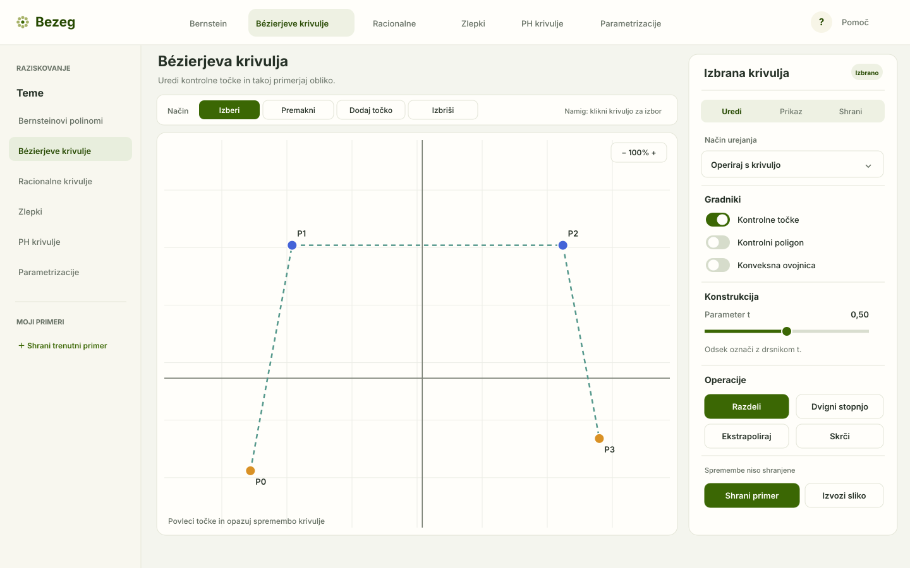
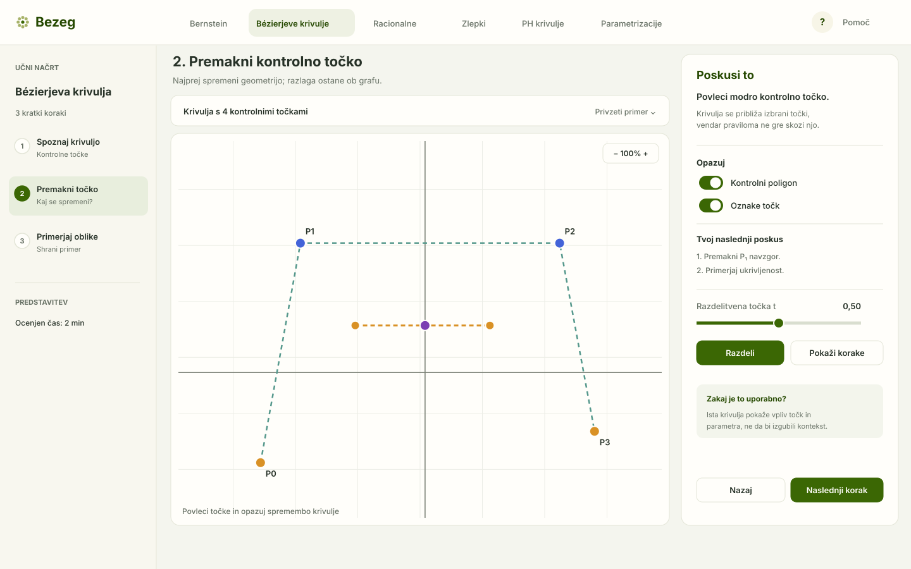
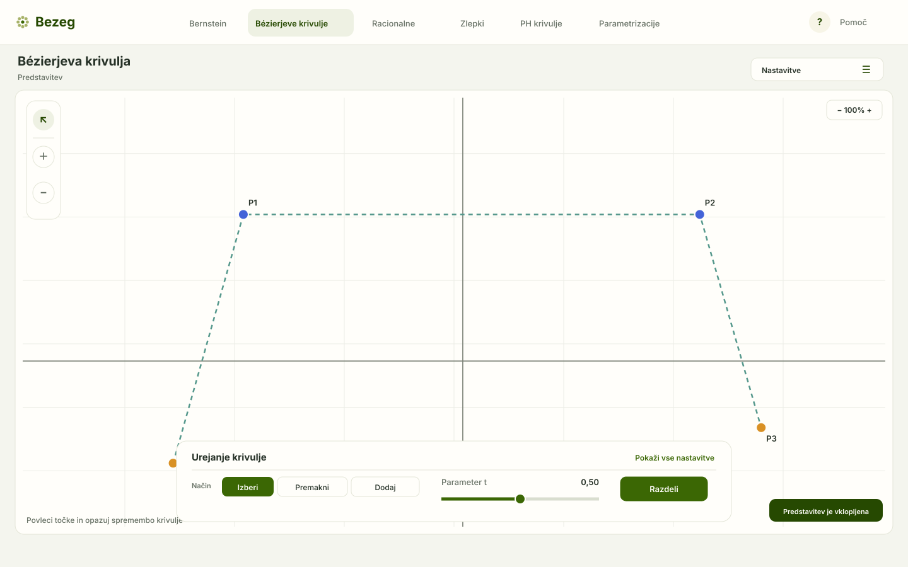
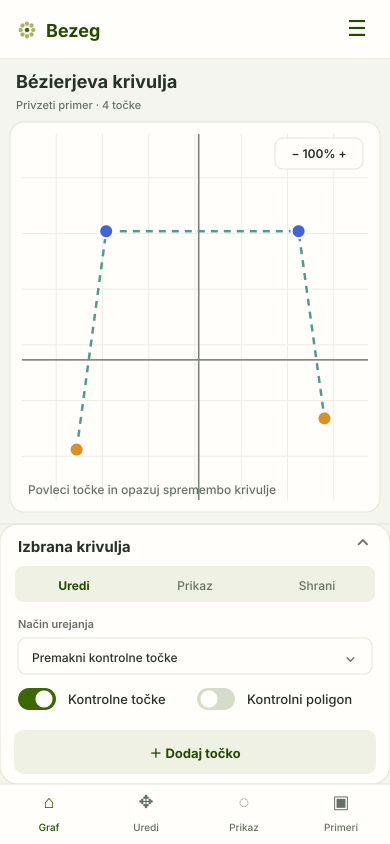

# Bezeg tools redesign proposal

This is a visual exploration based on the current UI and the project direction recorded on 2026-10-08. It is a proposal, not an accepted layout or a change to the app.

## What I reviewed

- The default polynomial Bézier route, both before and after selecting its curve.
- The De Casteljau construction route, including its curve visibility, animation, parameter, and speed controls.
- The cubic PH route, which exposes a different set of graph-level options.
- The source-based control inventory and product constraints in [UI functionality](../ui-functionality.md), [capabilities](../capabilities.md), and [product direction](../product-direction.md).

## Current experience

On a wide screen, a user sees three separate zones: general tools on the left, the graph in the center, and graph commands on the right. The left panel mixes axis style, a visual sizing slider, SVG/PNG export, local presets, and point labels. The right panel changes with the demonstration; selecting an eligible curve replaces graph commands with selected-curve controls.

Selection on the polynomial Bézier route revealed a second mode selector, three visibility switches, four numeric sliders, and operations such as subdivision, extrapolation, shrinking, and degree elevation. The De Casteljau route has its own construction and animation controls. Rational, spline, and PH demonstrations add their own parameter, weight, continuity, offset, or auxiliary-editor controls, so one generic static toolbar will not fit every page.

At the narrow browser width I reviewed, the navigation collapsed and the tools took a long vertical section above the graph. On the wide view, the graph was prominent, but the two side panels divided related controls across opposite sides. The presentation mode relies on hovering over hidden panels. The current help describes Shift+drag and Shift+wheel for graph movement and zoom. The label “Povečava” is also ambiguous: that slider changes point, line, tick, and text size rather than the graph viewport. Preset actions use small icons grouped together, with little indication that examples are stored in the current browser.

These observations describe the visible layout and source behavior. They do not establish a full accessibility audit or a usability study.

## Recommended direction

Use **A · Enoten pregledovalnik** as the default workspace: keep the graph in the center, make the left side a topic navigator, and gather contextual controls in one right inspector. Separate inspector sections for **Uredi**, **Prikaz**, and **Shrani**. The active selection and editing mode should remain visible, and controls should appear in named groups instead of moving between unrelated panels.

Borrow two ideas from the other concepts:

- From **B · Vodena učna pot**, add one-sentence guidance beside unfamiliar parameters and short prompts for demonstrations intended to teach a specific construction. Keep this help optional so experienced users can work directly.
- From **C · Graf za predstavitev**, make presentation controls explicit and reachable without hover. Keep the graph large, with a persistent button to open settings and a compact control strip for the active task.

For smaller screens, keep the graph at the top and place controls in a compact bottom sheet with tabs. This avoids making users scroll through every setting before they can see the graph. Keep touch targets large enough for finger use, and provide keyboard-accessible alternatives to graph gestures.

## Detailed interaction changes to consider

1. **Name controls by their effect.** Rename the current “Povečava” visual-size slider to something like “Velikost elementov grafa”, show its value, and explain that it affects points, strokes, ticks, and labels. Give viewport zoom its own visible control.
2. **Make editing modes explicit.** Replace the dropdown with visible modes such as “Izberi”, “Premakni”, “Dodaj točko”, and “Izbriši”. Keep the current mode visually selected and show a brief hint for the active mode.
3. **Explain parameters at the control.** Put the parameter name, current value, valid range or units, and a short explanation next to each slider. Preserve the mathematical meaning and domains already used by each demonstration.
4. **Keep contextual actions predictable.** Use a stable inspector section for construction controls and curve operations. If an action needs a selected curve, show the requirement and a clear way to select one.
5. **Make saving legible.** Separate choosing an example, saving, resetting, importing, and exporting. Label local storage plainly (for example, “Shranjeno v tem brskalniku”) and give import errors or replacement warnings useful next steps.
6. **Remove hover as a requirement.** Keep presentation controls available through click, touch, and keyboard. Show graph navigation controls for pan and zoom instead of relying only on Shift gestures.
7. **Use more than color to distinguish geometry.** Pair curve color with labels, line styles, point markers, and control-polygon styling so a classroom audience can follow the construction.

## Visual concepts

The images below are static mockups. Controls are illustrative and are not wired to Bezeg's geometry, presets, or exports. Open [the switchable preview](tools-redesign.html) to compare all four views; the arrow buttons and keyboard arrows switch variants.

### A · Enoten pregledovalnik — recommended base

### B · Vodena učna pot — for guided lessons

### C · Graf za predstavitev — for projection

### Mobile concept

## Before implementation

Treat the images as design options, not final product decisions. The first bounded implementation scope is in the [tools usability redesign spec](../specs/tools-usability-redesign.md). Review the chosen design at normal desktop, classroom projection, and narrow widths; check mouse, keyboard, and touch access; and keep the mathematical controls and stored preset behavior explicit.
