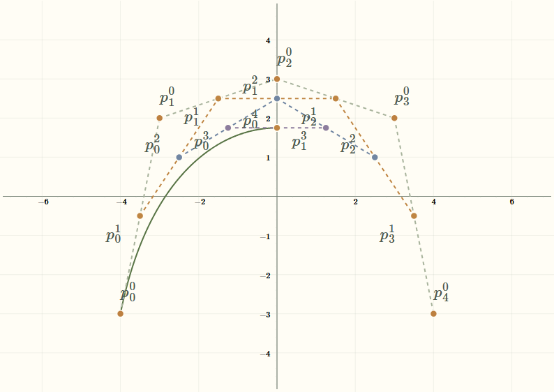

# Illustrated C graph styling — implementation evidence

The actual JSXGraph demonstrations now use moss primary curves, muted comparison and basis colors with line patterns, ochre editable markers with cream outlines, dark hover outlines, quieter construction geometry and axes, and sage spline joins. De Casteljau labels fan around construction levels on compact boards. The style is applied to existing mathematical objects; no geometry, evaluation, default scene, route, control, lesson content, preset schema, renderer, or export lifecycle was replaced.

## Matched real scenes

These are captures of real production boards at the same default inputs and bounds, not the portable schematic references. PH offsets are deliberately enabled in both members of that evidence pair; ordinary PH defaults remain unchanged. Each image opens at its original resolution. [Six-pair contact sheet](../../images/graph-visual-style/implementation/contact-sheet.png) shows the same actual boards together.

| Scene | Before | After |
| --- | --- | --- |
| Ordinary Bezier | [Before](../../images/graph-visual-style/implementation/bezier-baseline.png) | [After](../../images/graph-visual-style/implementation/bezier-final.png) |
| De Casteljau | [Before](../../images/graph-visual-style/implementation/decasteljau-baseline.png) | [After](../../images/graph-visual-style/implementation/decasteljau-final.png) |
| Rational Bezier | [Before](../../images/graph-visual-style/implementation/rational-baseline.png) | [After](../../images/graph-visual-style/implementation/rational-final.png) |
| PH with the existing offset enabled | [Before](../../images/graph-visual-style/implementation/ph-offset-baseline.png) | [After](../../images/graph-visual-style/implementation/ph-offset-final.png) |
| C1 spline joins | [Before](../../images/graph-visual-style/implementation/spline-c1-baseline.png) | [After](../../images/graph-visual-style/implementation/spline-c1-final.png) |
| Trigonometric function | [Before](../../images/graph-visual-style/implementation/trigonometric-baseline.png) | [After](../../images/graph-visual-style/implementation/trigonometric-final.png) |

## Source and capture provenance

Work began in a separate managed worktree from freshly fetched `origin/master` at `d0ca083`. Commit `ecc17fa` imported only this task's spec and reference documents. Unrelated changes in the owner's original checkout were preserved. Baseline graph code is therefore `d0ca083`; its immutable production build is `main.cc3c7938.js`. Graph styling is committed as `a72af4b`. Final graph verification uses `main.9f88cc12.js`, with CSS `main.05771437.css`, served from this task's worktree at `http://127.0.0.1:4186/bezeg-2.0`. After faithful catalog regeneration, the running preview uses `main.5541c91b.js` with the same CSS and graph source; its JS hash changes because the embedded catalog asset URLs changed. Catalog manifest hashes verify all 29 PNGs against graph source `a72af4b`.

Captures use Chromium 156.0.8078.4 on Windows 10.0.26200, Slovenian locale, light scheme, DPR 1, and desktop 1440×850. The four pilots also have 390px and 724px browser-viewport captures, plus De Casteljau browser presentation mode and the PH generating-point board. MathJax startup/typesetting and browser fonts settle before each capture. The baseline and final edited scenes use the same exact free-point coordinate fixture through supported controls or normal drag handling; a synthetic gesture alone is not treated as proof of identical inputs.

Reusable commands and their options are in [the evidence tools](../../../scripts/graph-visual-style/README.md). Bulk screenshots and scene JSON remain in ignored `.benchmark-output/graph-style`; selected matched images and machine-readable comparisons are retained here.

## Verification

- TypeScript passed with `npx tsc --noEmit --pretty false`.
- Full unit suite passed: 70 suites, 800 tests on the final source. The hidden Windows worktree required an explicit normalized `--testMatch` path; no tests were skipped or weakened. Three earlier subdivision fixture failures were repaired by providing the renderer stub now used for appearance roles, retaining the existing mathematical assertions.
- Production build passed with `CI=false`; existing CRA/Babel, Browserslist, lint, and bundle-size warnings remain. The newly unused PH import was removed.
- The full automated production browser suite passed all 120 checks on `main.d8c651b6.js`. It covers all 29 routes, edited-scene language and preset workflows, every allowlisted lesson, English exit/re-entry restoration, narrow lesson walks, shared lesson keyboard behavior, and export ownership. The subsequent source changes are compact label anchors, hover outline contrast, explicit marker fill/outline attributes and dark labels, test fixtures, and conceptual illustration colors; final checks for those changes are recorded separately.
- Final supplemental checks passed on `main.9f88cc12.js`: actual SVG/PNG downloads with typeset math, transparent SVG/cream PNG, normal cream marker outlines and dark hover outlines, selection, size/visibility controls, keyboard focus, 390px/724px labels, and the isolated higher-count preset. PH auxiliary independence passed on the preceding style-equivalent auxiliary build. See [smoke scope and limitations](smoke.md), [UI observations](ui.json), [auxiliary observations](ph-aux.json), and [export observations](exports.json). [SVG](../../images/graph-visual-style/implementation/decasteljau-export.svg), [PNG](../../images/graph-visual-style/implementation/decasteljau-export.png), and [transparent SVG render](../../images/graph-visual-style/implementation/decasteljau-export-transparent.png) are retained.
- Numeric comparison covers 35 scenes (29 defaults, four matched edited pilots, presentation, and enabled PH offsets): points and bounds are exact, with zero change across 245 evaluations of 49 finite-domain curves. Object metadata and role counts remain exact. These are five parameter evaluations per finite-domain curve, not full rendered-path comparisons; weights and slider values are not serialized separately, and the linear route has no finite-domain curve samples. Source review and mathematical tests supplement those limits. See [raw comparison and exact coverage](comparison.json). Final seven-interaction timing evidence and its limits are in [the performance report](performance.md).
- Faithful catalog regeneration completed from `a72af4b`: all 29 actual default-route PNGs and their SHA-256 hashes are verified against the manifest. After rebuilding as `main.5541c91b.js`, 36 final production browser checks passed: catalog expansion and all image loads, all 29 route workspaces, the alternative De Casteljau SL/EN/narrow lesson walks and state restoration, and observation controls/animation lifecycle. Command: `SMOKE_PORT=4188 npx playwright test tests/demonstrations.smoke.spec.cjs tests/guided-lessons.smoke.spec.cjs --grep "renders its heading|demonstration catalog|Lesson decasteljau-alternative|Observation flow"` (set the environment variable using the current shell).

## Independent review

A GPT-6 Luna worker at Max reasoning reviewed mathematical fidelity; another independently reviewed engineering constraints, UI, and accessibility. Source review found no change to curve evaluation, constructions, bounds, ownership, cache invalidation, toggle coupling, or PH auxiliary independence. The handler reviewed the complete diff and captures.

A renderer-level SVG test now checks actual point fill and outline attributes; it caught JSXGraph's `color` alias overriding explicit marker outlines. The alias was removed from marker styles and selection updates. The final focused verification passed three suites and ten tests, including this real-renderer regression check, followed by TypeScript. The engineering review's pale-hover-outline finding was repaired with the dark selected-point outline, and its unused-import finding was repaired. Its compact De Casteljau collision finding prompted the final level/row fan placement. Bernstein term labels now use a common dark text color for readability; their exact indexed formulas and distinguishable curve colors/line patterns remain. The blue left/orange right subdivision lesson and blue main/orange reference function descriptions keep their meaning in both languages, so no lesson copy or localization keys changed.

## Limits

Evidence is from headless Chromium and simulated browser widths. It does not establish physical phone latency, projector readability, touch ergonomics, a comprehensive accessibility audit, or production-hosting acceptance. Dense construction labels can still crowd when users move points together or increase counts; existing C1 join-label crowding is retained. This change does not add a general collision solver, alter point coordinates, hide notation, or replace the renderer. The previously documented PH development-StrictMode issue is outside this production styling task.
