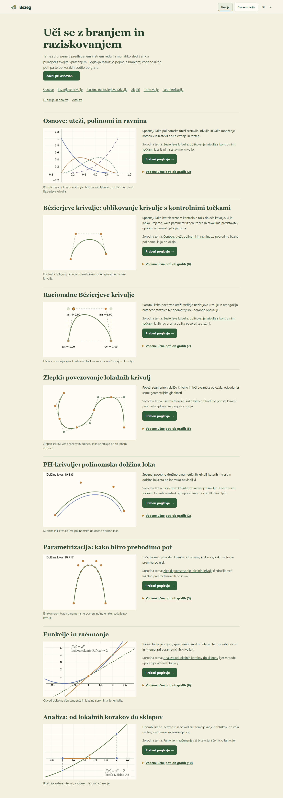
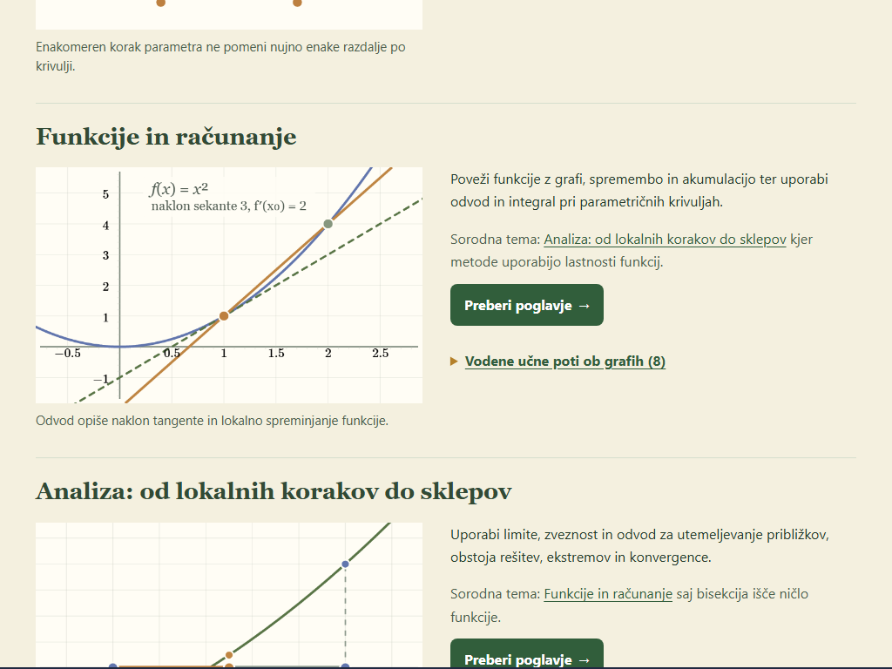
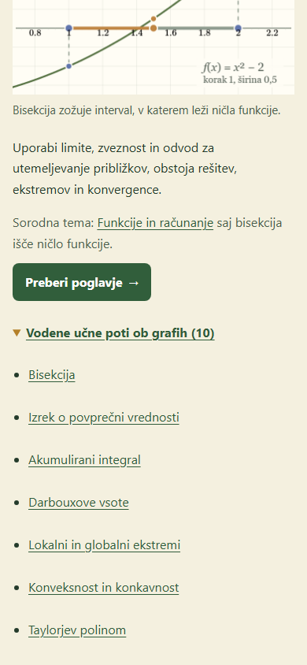
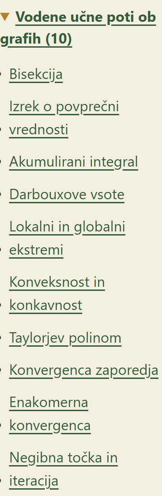
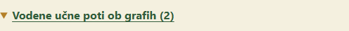

# Learn landing browser smoke

**Result:** the selected landing-page checks passed after the lesson-link target repair. The review ran from 2026-10-26 00:35:51 to 00:44:18 +01:00 against the production preview at [http://127.0.0.1:4387/bezeg-2.0/learn](http://127.0.0.1:4387/bezeg-2.0/learn). Checkout revision was `b60b00f58d440c2909b13b472ea0e06cc9a0164c`; the app and smoke files were dirty during the run. Chromium was headless, version `156.0.8078.4`.

The isolated smoke command `just smoke-built tests/unified-learning.smoke.spec.cjs --port 4388 --workers=1` passed **9/9 tests in 22 seconds** on the pre-repair dirty build. Its own server on port 4388 was disposed by the runner. The handler rebuilt the production preview on port 4387 after adding a 44px minimum to guided lesson links; the focused recheck below used that rebuilt preview. I left the handler-owned 4387 preview running. The smoke log contained only Node's `NO_COLOR`/`FORCE_COLOR` environment warning; the rebuild log also reported the existing Vite history bridge bundling warning and Bootstrap Sass mixed-declaration deprecation.

| Check | Status | Observed evidence |
| --- | --- | --- |
| Landing inventory and board ownership | **Passed** | Eight topic sections, eight chapter actions, 45 unique guided-lesson destinations, and no JSXGraph board elements on Learn. The Foundations start action opens `/learn/foundations`. |
| Previews, alt text, and captions | **Passed** | All eight lazy images decoded at 720×440 after scrolling into view. I visually inspected each graph and caption; each description matches the displayed graph, and switching to English changes all eight alt/caption pairs and the page copy. The full-page desktop capture shows the complete previews. |
| Reading and guided-lesson entry | **Passed** | The introduction describes suggested order, chapter reading, and step-by-step graph lessons. Each topic has one chapter heading and one read action, a related-topic link, and a native lesson disclosure with a count. The automated Foundation flow opens the graph and guided lesson, then Back returns to Learn. |
| Keyboard and focus | **Passed** | Enter opened and closed all eight disclosures. All 45 lesson links are native tabbable links. Keyboard focus on a disclosure showed a visible 3px solid outline. |
| Touch-target heights | **Passed after repair** | The initial preview measured all 45 expanded lesson links at 36px. After the handler's CSS repair, all 45 measured 44px; primary read actions measured 48px and topic/disclosure targets 44px. |
| Responsive and enlarged text | **Passed** | No horizontal document overflow at 1440×1000, 1024×768, or 390×844. At 390×844 with the root text size set to 200%, the 10-item Analysis list expanded to its content height, remained unclipped, and the document stayed 390px wide. |
| Hash return and browser history | **Passed** | The Analysis topic anchor, reader return, refresh, Back to reader, and Forward to `#analysis` all worked. The final heading remained visible. Since Analysis is the final topic, the browser is bottom-clamped: `scrollY=3054`, maximum scroll `3054`, `bottomGap=0`, heading top 571px in a 1000px viewport. |
| Runtime errors | **Passed** | No console errors, page exceptions, or failed requests in the live-page runs. |

Screenshots were captured and visually inspected at the representative viewport sizes. The full automated record and post-repair measurements are in [landing-browser.json](landing-browser/landing-browser.json) and [landing-recheck.json](landing-browser/landing-recheck.json).

Coverage limits: 1024px is a browser viewport check, not a physical projector test. I did not exercise unrelated graph-family dragging/sliders, preset persistence, physical touch devices, or comprehensive accessibility; the change did not alter those routes or runtimes. The broader app-shell checklist was not needed for this landing-page-only change.

Handler acceptance, 2026-10-26: reviewed the diff, desktop/narrow screenshots and repair measurements. Accepted all section 2 criteria; stopped the handler preview after the worker completed its browser checks. The completed worker handoff was incorporated here. Build/typecheck/lint and focused unit evidence are recorded in the implementation notes and evaluation record.
