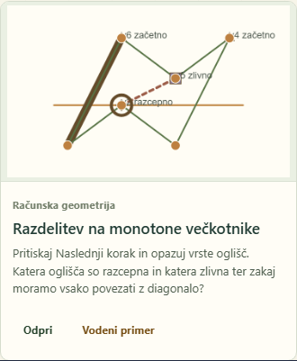

# Graph review calibrated to the owner's negative examples

Method: three independent fresh-context Luna Max reviewers, followed by handler reproduction and evidence review. Findings only; no application changes. This is a focused construction-visibility and highlight-style review, with [45 lesson inventories](visibility.md) and [45 native catalog cards](previews.md), rather than another complete lesson walkthrough.

**The earlier assessment was too forgiving.** Calling interval sweep a strong visual reference was a mistake against the owner's supplied standard. The polygon-area issue also deserved higher priority than its previous P3 placement: it prevents seeing the construction being taught.

## Owner-confirmed cases, rechecked

| Case | Verified visible problem | Disposition |
| --- | --- | --- |
| **Polygon area — construction visibility** | At `/bezeg-2.0/compgeo/polygon-area`, open **Uredi** and keep **Trikotniki iz prvega oglišča** checked. The three positive fan components share a continuous green fill without visible internal boundaries. The area values appear, but a learner cannot point to the three corresponding triangles; one value also overlaps a lattice mark. The handler checked the control true/false and inspected both boards. | **High priority educational visibility problem**, not a minor palette preference. Preserve the signed-area encoding while adding visible component boundaries or another separation cue. [Owner reference](references/polygon-area-invisible-triangles.png), [enabled board](evidence/handler/polygon-area-fan-enabled-board.png), [disabled comparison](evidence/handler/polygon-area-fan-disabled-board.png), [enabled control](evidence/handler/polygon-area-fan-enabled-workspace.png). |
| **Interval sweep — native card** | On `/bezeg-2.0/demonstrations`, the default poster lays a broad dark brown/olive band around a green interval. It reads as a heavy muddy bar at native card size. A larger board's otherwise clear roles do not justify this treatment. | **Confirmed owner aesthetic rejection.** Corrects the earlier positive comparison. Keep the active-interval meaning while reducing the layered stroke's weight and revisiting its hue. [Owner reference](references/interval-sweep-heavy-highlight.png), [native card](evidence/previews/poster-interval-sweep.png). |
| **Segment intersections — native card** | Dark brown/olive backing and green segment centers produce broad crossing ribbons around the current event. | **Confirmed owner aesthetic rejection.** This poster is distinct from the previously reported terminal coincident-event knot; do not collapse the two scenes. Retain every participating segment and event while giving the active treatment a cleaner hierarchy. [Owner reference](references/segment-intersections-heavy-highlight.png), [native card](evidence/previews/poster-segment-intersections.png). |

The source supports the polygon observation: `PolygonAreaGraph.tsx` hides fan borders and gives all positive components the same fill. Presence of triangle objects in the board is therefore insufficient evidence of a visible triangle decomposition. No mathematical evaluation failure is claimed.

## Additional matching evidence

**Monotone partition's catalog card is a close style match.** Its left active polygon edge becomes a thick brown/olive strip with green running through it, beside thin green edges, an orange sweep line, and a large event ring. This repeats the objectionable ribbon treatment at native media size, **328×200 CSS px** inside a 330 px wide card. Confidence in the visual match is medium; the owner has not independently rated this additional example. The board treatment was already mentioned in the previous audit: this is **newly checked card evidence of that concern**, not a newly discovered independent defect. A narrower active cue should preserve which edge is current without sandwiching green inside a broad dark band. [Native card](evidence/previews/poster-monotone-partition.png), [handler reproduction](evidence/handler/monotone-partition-card-1440.png).

**Monotone triangulation has a further, weaker lesson-state match.** At `/bezeg-2.0/compgeo/monotone-triangulation`, open **Spoznaj to demonstracijo** and advance six frames to **Korak 4 od 7 · Okvir 1 od 2**. The scene combines 5 px green active geometry, a 3 px brown dashed construction laid over a green edge, a warm triangle fill and a dark event ring. The overlapping strokes make a local striped, muddy edge. This is a **medium-confidence aesthetic candidate**, narrower than the broad ribbons in the owner's cards; the construction remains readable. The handler independently reached this exact frame and compared it with **Korak 7 od 7 · Okvir 2 od 2**, where the polygon edges return to 2 px green. Preserve the triangle, current vertex and diagonal sequence, but give the active edges and added construction distinct cues without superimposing competing colors. [Active board](evidence/highlights/monotone-triangulation-step4-frame1-graph.png), [resting board](evidence/highlights/monotone-triangulation-final-step7-frame2-graph.png), [handler's active scene](evidence/handler/monotone-triangulation-active-board.png), [scene recipe and measurements](highlights.md#additional-scene-candidate).

The **monotone-triangulation card is not the same finding**: it mainly shows thick green edges and a separate event ring. The native-card reviewer rejected it as a brown-ribbon match. That disagreement narrows the claim to the specific lesson frame above.

## Coverage and limits

- Both lesson reviewers screened the previous opening/middle/final samples for all **45 lessons** (135 sampled scenes each). Broad screening used contact sheets, with selected full-size checks and targeted live reproduction; intermediate frames and every optional construction toggle were not exhaustively reviewed.
- The visibility reviewer retained **no additional confirmed invisible-construction case**. Full-size ear-clipping and point-set triangulation edges remained separable. Convex-hull and monotone-triangulation terminal resets are explicitly free exploration, so they were rejected as missing-construction findings. The reviewer reached its input-budget signal; the handler consolidated its 45-row ledger from the [handoff](visibility-handoff.md) and reproduced the known polygon case.
- The card reviewer inspected **all 45 default static posters** at a 1680×1100 viewport, DPR 1, retaining native card dimensions in unscaled contact sheets. All scoped posters have 720×440 source images and approximately 328×200 displayed media. The handler independently checked the four relevant cards at 1440×1000 with the same native media size. None of these 45 IDs has a shipped hover-motion asset. See [card inventory](previews.md#45-card-screening-inventory) and [archived capture manifest](evidence/previews/cards-manifest.json).
- The two additional entries above mean **one newly found lesson-frame candidate and one newly inspected card surface of an old concern**. They are not two new app-wide defects. “No match” in an inventory is limited to the calibrated concerns and sampled states.
- Target: the frozen production output recorded as `d2a3b6465f541c687811692f4ae1b3f720483141`, whose provenance says `dirty: true`. HEAD at dispatch was `27f6ac07`; app sources, scripts, package files and Vite configuration had no committed differences from the recorded build revision. No new build, unit suite, general accessibility audit or physical projection test is claimed.
- Impeccable's context/detector setup had already failed in this session. Existing PRODUCT.md/DESIGN.md and rendered evidence were used. No detector result, overlay, score, snapshot or trend is claimed. The three independent human-style visual review slices were calibrated with the owner's references; they were not a replacement deterministic scan.

## Wording that would catch this class of problem

> Use these screenshots as negative calibration examples. Audit the lesson boards and their catalog previews at actual display size. For each enabled construction, check whether a learner can distinguish the parts the lesson says are present. For active states, examine color, stroke width, overlapping outlines, dashes and event markers; explicitly flag muddy brown/green ribbons and harsh emphasis even when the geometry is readable. Compare active and resting states. Return exact routes, states and screenshots, and separate known examples from additional matches. Findings only; preserve mathematical meaning.

This is more discriminating than asking for a general palette critique. It makes **visible construction** and **the appearance of emphasis at shipped size** explicit review criteria. The owner should not have to supply a new screenshot for every instance; the examples calibrate how reviewers inspect analogous states.

## Verification and cleanup

The focused review was accepted with the coverage limits above at **2026-11-03 21:02:58 UTC**. All 71 PNGs decoded and passed dimension/nonuniform-content checks; all 154 local Markdown links resolved. The card manifest has 45 unique IDs, and the three owner-reference SHA-256 hashes remained unchanged. The handler directly inspected the primary finding images and reproduced the polygon toggle, relevant cards and triangulation active/resting states. Only audit documents and evidence were changed; no new application build or tests were required.

All worker browsers were closed. The handler verified each newly owned preview PID against its Vite command line, frozen output path and dedicated loopback port before stopping it; ports 4323–4325 had zero listeners at 21:02:58 UTC. Temporary capture scripts and logs remain ignored under `.command-logs/reference-calibrated-graph-ux-2026-11-03/`; no detector live server or injected overlay was created. Unrelated `.claude/jobs/` and `debug.log` were preserved.

Questions skipped: the owner requested findings only and already authorized the subagent review.
