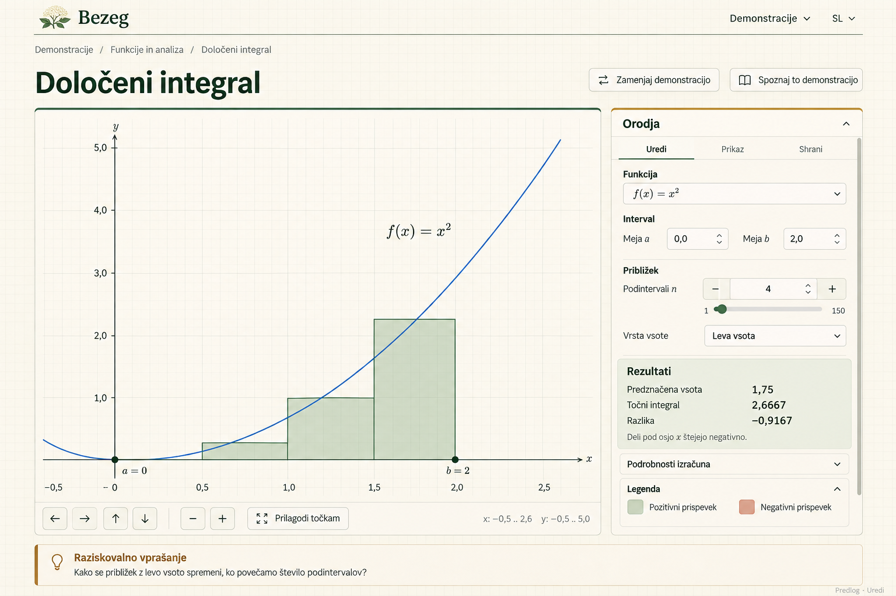
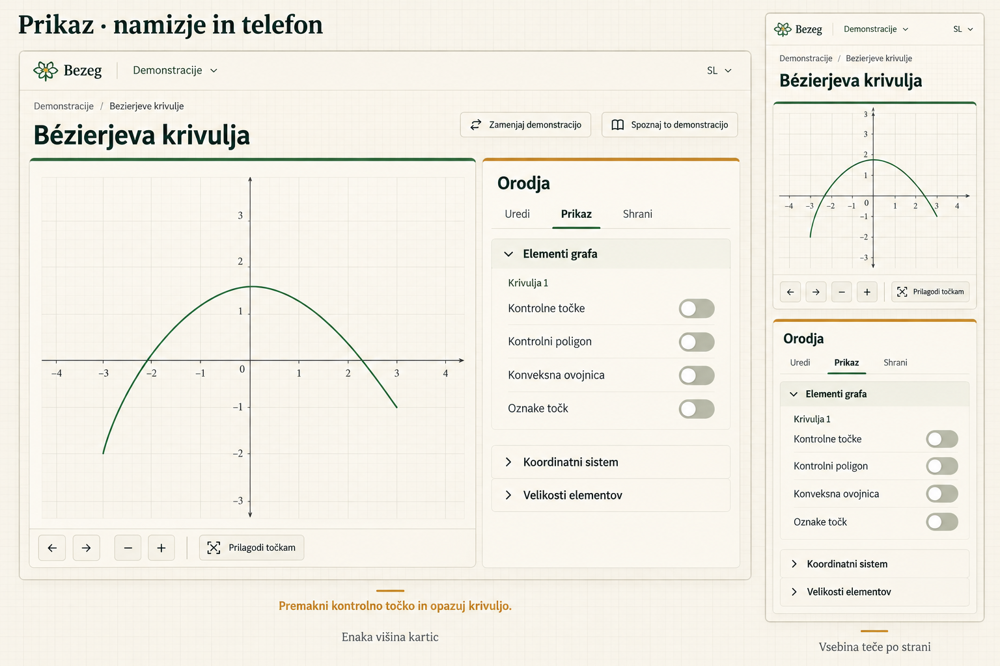
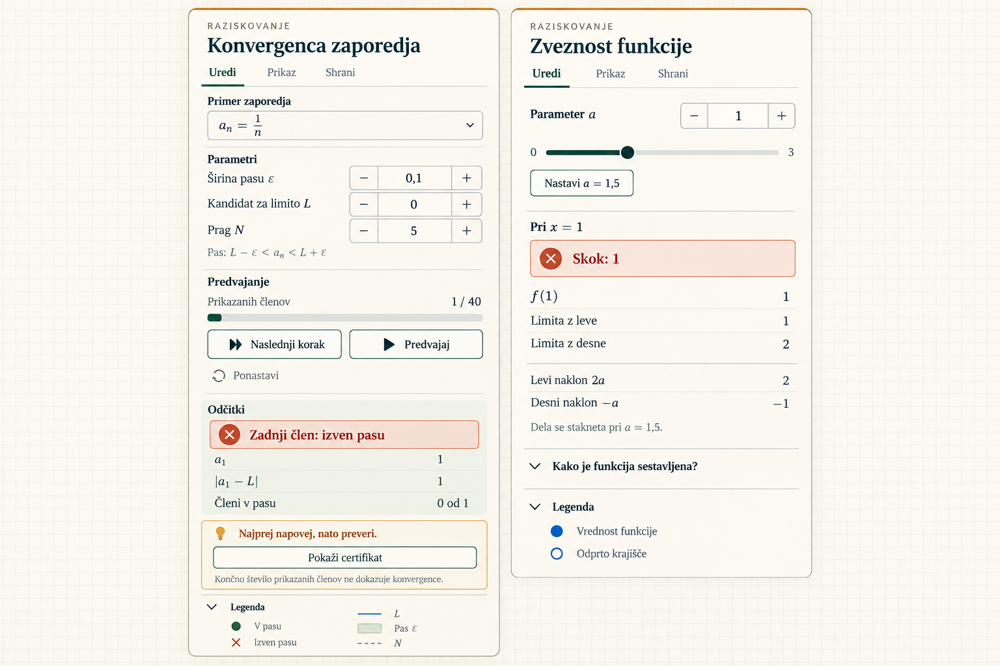

# Demonstration controls UX redesign

**Status:** specification and visual references authorized for publication by the owner on 2026-10-16. Images remain directional guidance subject to the written requirements. Implementation authorized by the owner on 2026-10-16 and implemented on that date; the control inventory, accepted exceptions and open decisions are in [the task record](../tasks/demonstration-controls-ux/inventory.md).
**Date:** 2026-10-16.
**Source:** owner interview following the sequence-convergence and continuity inspector review, the older-family review, and the requested Display ordering.

## Problem

The demonstration inspector mixes editable parameters, results, explanations, visibility settings, and operations with insufficient hierarchy. Long readouts and help text can precede the controls needed to explore the graph. Older families add inconsistent counters, unclear weight navigation, generic parameter labels, and nested scrolling. Shared coordinate-system and element-size controls currently precede the graph-specific Display options.

Improve discoverability, precise input, and the relationship between a control and its visible mathematical effect. Retain the graph-centered workspace and make the controls look like part of the surrounding Bezeg site.

## Scope and sequencing

- Apply one coherent control system to every demonstration family: Foundations, Bézier, rational Bézier, splines, PH, parameterizations, functions/calculus, and analysis. Include demonstrations shipped by the implementation checkpoint; do not freeze coverage to today's route count.
- Cover both free exploration and the same controls used inside Guided lessons. Individual lesson names are not required to define shared behavior. Inventory all active routes and relevant lesson states before implementation; record any exception explicitly.
- Prepare and review this specification and image examples now. Implement only after the ongoing lesson work reaches a stable checkpoint and implementation is authorized. Publication of the spec is a separate, owner-controlled step.
- Preserve unrelated working-tree changes. No application code, localization catalogs, lesson content, routes, or presets change during this specification stage.
- This follows the implemented [tools usability redesign](tools-usability-redesign.md), [learning workspace](learning-workspace.md), [calm controls](calm-tools-prototype.md), and [scrollbar spacing](inspector-scrollbar-spacing.md). The new desktop height and phone scrolling decisions below supersede their conflicting layout provisions only when implemented.

## Agreed visual direction

- Preserve the elderflower identity, warm cream/ivory surfaces, forest green, quiet sage, and restrained ochre accents. Fit the existing header, page titles, graph cards, typography roles, borders, and surrounding background.
- Keep the graph visually dominant. Review complete page compositions as well as isolated controls; a handsome inspector crop alone is insufficient evidence.
- Use a compact contextual tools heading and retain stable **Uredi / Prikaz / Shrani** tabs. Reduce repeated introductory text above the controls.
- Use consistent field heights, spacing, alignment, border treatment, and focus states. Support longer English text without fixed label widths or clipping.
- Distinguish editable fields from output. Use aligned, tabular numeric readouts and modest emphasis for primary results rather than oversized dashboard tiles.
- Normal mathematical observations such as a jump or a term outside the selected band are informative states, not input errors. Use restrained color plus text/symbols; reserve error treatment for actual invalid input or failed actions.
- Generated images are directional examples. Their mathematical drawing, text, precise spacing, and any extra depicted affordance are not acceptance criteria unless supported by this specification and the real demonstration.

## Information architecture

### Edit

Default order: **example or explicit selection → parameters → actions → results → supporting explanations**.

- Adapt the order locally when keeping an operation beside its parameter or keeping related comparison results together makes the mathematical task clearer. Document exceptions; do not invent different family-specific styling systems.
- Primary parameters, playback controls, and key results remain expanded. Advanced operations and lengthy explanations use keyboard-accessible disclosures.
- Keep approximate/exact/difference results together where comparison is the task. Avoid repeating every editable parameter in the readout; retain all meaningful quantities, definitions, and edge-case information through the reorganized controls or details.
- Keep related numeric fields together, such as interval endpoints. Keep a field's relevant domain restriction or validation guidance next to that field.
- Keep essential mathematical caveats visible. Longer derivations and extended help may collapse; disclosure must not conceal the distinction between finite illustration and proof, signed integral and unsigned area, undefined and numeric values, or a numerical approximation and an exact result.
- Short legends stay visible. Longer legends may collapse. Match swatches to actual graph markers, line patterns, and shaded regions; prefer concise mathematical labels over prose describing each shape.

### Display

Use this order on every applicable route:

1. **Graph-specific elements:** construction lines, tangents, control polygons, point labels, shaded regions, offsets, and other demonstration-specific visibility options and associated results.
2. **Coordinate system:** existing axis/coordinate-system choices and other supported coordinate-context settings.
3. **Element sizes:** existing visual element sizing, clearly distinguished from viewport zoom.

Keep graph-specific settings expanded by default. Coordinate-system and element-size groups are collapsible and initially collapsed. Preserve every supported setting and its current mathematical meaning; grouping does not authorize adding settings the graph does not support. Preserve existing coupled sizing where applicable; independent sliders for every element type are not required.

Display-only options should have one understandable home. A mathematical parameter remains in Edit even if a nearby Display toggle controls whether its construction is visible. Group dependent Display settings beneath their controlling option, preserving their enabled/disabled rules.

### Save

Retain current Save workflows, browser-local explanations, import validation/replacement handling, and figure export. Apply only shared visual and accessibility improvements. Do not introduce storage, schema, navigation, or workflow changes.

## Control behavior

### Numeric parameters and counts

- Provide precise numeric entry alongside sliders where the value is editable. Use consistent **− / editable value / +** steppers where useful, particularly integer counts and rational weights.
- Preserve each parameter's existing valid domain, step, units, limits, and indirect update behavior. Never use a universal step or round a value merely to fit a presentation format.
- Show actual integer counts as integers and use the application's localized formatting for other values. Support the appropriate decimal-entry conventions in Slovenian and English.
- A temporary incomplete or invalid text draft must not corrupt graph state or silently become zero. Keep errors actionable and associated with the field. Define and verify the commit behavior during implementation; valid slider/stepper changes continue to update the graph immediately.
- Slider, numeric field, and graph must agree after direct edits, dragging, Reset, lesson scene actions, preset restore, and language changes. Focus and text editing must remain usable during updates.
- Use specific parameter names, not an isolated generic “Parameter.” Show supported bounds and concise explanatory help where needed.
- Give Reset an explicit label and preserve its existing scope. A value displayed as a button must not hide an unexpected reset action.

### Selection, previews, and operations

- **Do not automatically select a curve**, even if there is only one. Preserve the no-selection state because selection can add unwanted graph clutter or change interaction meaning.
- Opening tools, switching tabs, or expanding a section must not select a curve, reveal a construction, change parameters, or otherwise mutate the mathematical scene.
- Expose curve-dependent operations only after explicit selection, with a compact prompt explaining that requirement. Clearly identify the active curve and, for weights, the active point/weight index.
- Preserve existing deselection, editing modes, constrained/derived-point behavior, and supported keyboard coordinate editing. Do not make constrained points editable for visual uniformity.
- Distinguish **Preview**, **Apply**, and **Reset**. Reorganizing controls must not turn a preview into a geometry mutation. A preview must be explicitly accessible through keyboard and touch rather than depending only on hover.
- Group operation parameters and actions together. Retain advanced-operation disclosures where they already improve scanning.

### Playback and lesson reveals

- Group Next step, Play/Pause, and existing Reset/Stop/Replay controls coherently. Use the same visual language in De Casteljau and analysis demonstrations while preserving their distinct behavior.
- Show the current parameter/count and playback state without unnecessary repetition. Do not add playback to demonstrations that do not support it.
- Keep reveals in a distinct area with concise prediction guidance when appropriate. Preserve hidden/revealed state, cancellation, termination, and existing lesson sequencing.
- Do not add answer-revealing shortcuts during prediction stages. In particular, the prototype's shortcut to the continuity matching value is not an approved default control.
- Do not claim convergence or issue a certificate from a finite plotted window. A result remains hidden until the existing explicit reveal action requests it.

### Disclosure state

Preserve expanded/collapsed state while switching tabs during the current visit to a demonstration. Opening another demonstration starts with its agreed defaults. Do not persist panel layout in browser storage or presets. Expanding or collapsing a group is a UI-only action; preserve scene state and avoid reinitializing graph objects.

## Layout and accessibility

- On desktop, align the inspector frame's top and bottom with the graph card, **including the graph navigation footer**. The graph card determines the height; expanding controls must not stretch the graph.
- Keep the inspector heading/tabs accessible and scroll only the content beneath them. Use one content scroll owner; remove nested control-panel scrolling. Short content may leave empty space rather than inflating controls.
- On phones, keep the graph before controls and let inspector content flow naturally in the page. Remove the fixed-height inspector scroll region. Retain tab switching, collapse access, and usable presentation-mode controls.
- Maintain symmetry of content insets when no scrollbar is needed; do not restore an empty reserved scrollbar gutter merely to hide layout problems.
- Keep keyboard focus visible, control names meaningful, disclosure states exposed, and hidden controls out of the tab order. Essential actions must work without hover and without color perception alone.
- Aim for at least 44 CSS pixel touch targets, allowing compact desktop appearance with adequate hit areas. Preserve readable labels, native keyboard stepping, and accessible slider values.
- At text enlargement, permit wrapping/reflow without clipping fields, values, tabs, or actions. Preserve the desktop height rule only where all controls remain reachable; use the flowing layout when space requires it.

## Family applications and coverage matrix

This matrix specifies representative patterns, not an exhaustive lesson-name list. Before implementation, reconcile it with the active route catalog and add any missing pattern or exception.

| Family / representative | Required design checks |
| --- | --- |
| Foundations / Bernstein | Explicit degree/count label, conventional stepper, integer formatting, separate chart visibility |
| Bézier / general curve, subdivision, elevation | No-selection and selected states, parameter/action grouping, Preview versus Apply, degree elevation, keyboard point editor |
| Bézier / De Casteljau | Grouped playback, parameter/speed controls, state transitions, construction visibility |
| Rational / base and construction routes | Explicit curve and weight identity, precise weight entry, separate reset, standard-form and visibility behavior, no nested scrolling |
| Splines / representative constrained variants | Clear point visibility/labels, constraints preserved, no newly editable derived points |
| PH / cubic and quintic | Offset visibility/count/distance and dependent options, geometry and arc-length controls, auxiliary board reachability |
| Parameterizations / alpha, weighted, uniform | Named parameters, integer sampling counts, separation of sampling and point-display settings |
| Functions / integral | Function, interval, subdivision count and method; signed approximation/exact/difference comparison and caveats |
| Functions / continuity, derivative, trigonometric | Neutral mathematical status, precise entry, valid-domain guidance, tangents/reference visibility, no premature reveal |
| Analysis / sequence | Parameters, finite term count, playback, band membership, strict-band caveat, hidden/revealed analytic certificate |
| Analysis / bisection, accumulation, Darboux, Taylor, uniform convergence, fixed point where shipped | Applicable iteration/refinement/degree controls, comparison results, dependent visibility, hidden reveals, pause/reset/termination semantics |
| Every active demonstration | All existing controls and results accounted for; graph-specific Display options precede coordinate system and sizes |

## Acceptance and verification

1. Review image examples in the surrounding site before selecting the visual reference. Record owner feedback here. Do not treat generated copy or extra controls as approved requirements.
2. At implementation start, inventory controls/results for every active route and relevant lesson state. Every item has a retained destination or an explicitly approved exception; no family loses a capability during shared styling work.
3. Demonstrate the Edit hierarchy and exact Display order on simple functions, a selected rational curve, a constrained spline, and PH controls. Review both selected and unselected curve states.
4. Verify desktop card alignment and one inspector content scroller at representative 1440×900 and 1024×768 views. Review phone flow at 390×844, an intermediate width around 724 CSS pixels, text enlargement to 200%, and projection readability. Adjust exact viewport coverage to actual breakpoints and report gaps.
5. Check Slovenian and English, long labels, numeric entry, invalid/incomplete drafts, bounds, keyboard stepping, touch alternatives, focus, disclosure memory, and presentation mode. Physical-device/projector checks remain distinct from browser emulation and require explicit evidence or a reported gap.
6. Verify graph/control synchronization after dragging, Reset, synchronous multi-action lesson scenes, preset restoration, and language changes. UI-only actions preserve graph selection and visibility, reveal state, geometry, and running-state semantics.
7. Preserve routes, preset compatibility, import/export, mathematical outputs, strict inequalities, undefined states, and approximation/proof distinctions. Use relevant existing mathematical/property tests when control wiring changes; do not replace exact constructions with approximations.
8. Run focused behavioral tests, TypeScript (`npx tsc --noEmit --pretty false`), production build, and the repository-required shared-workspace/lesson browser checklist through the smoke-tester workflow. Shared shell changes require full checklist coverage, not only the pictured routes. Keep every lesson's smoke coverage and mathematical-notation checks intact.
9. Obtain independent mathematical/engineering and UI/accessibility review for the multi-file implementation. Record failures, unverified coverage, and accepted exceptions before release.
10. No implementation commits accompany this planning work. After image review, the handler may commit and publish only this task's approved spec/reference files when the owner authorizes it, preserving unrelated ongoing lesson/catalog changes.

## Boundaries and implementation guidance

- Keep the static, client-only architecture and existing technology stack. No renderer, build-tool, typography-system, or application-wide navigation migration.
- No route/default-scene changes, new lessons, curriculum behavior, auto-selection, new mathematical capabilities, answer shortcuts, persistent layout preferences, or preset format changes.
- Use the shared workspace and reusable control primitives for consistent presentation. Keep graph-specific constraints and commands owned by their graph/domain layer; do not introduce geometry into generic UI components.
- Preserve explicit board/listener/auxiliary-object disposal and synchronous lesson scene state. A presentation refactor must not revive graph-field mirrors or trigger graph creation during React render.
- Proposed seams: shared inspector layout and tab/disclosure UI; shared input/action/readout presentation; graph-provided control grouping. These are guidance for bounded implementation slices, not a requirement for a broad renderer or graph-model rewrite.
- No intentional breaking change is approved. If implementation discovers a need to alter a route, stored data, operation meaning, or other established behavior, return it for an explicit decision and document user impact.

## Visual review record

The owner requested retaining these images with the specification so implementation agents can inspect them without conversation history. They are repository-local visual references, **not final visual approval**. Read the requirements above first; if an image conflicts with them, follow the written requirements. Inspect full-page examples before the isolated-panel exploration to preserve the relationship to the surrounding site.

### Edit in the desktop workspace

Use this example for parameter grouping, precise entry alongside sliders, aligned comparison results, the compact tools header, and equal-height graph/inspector cards. Retain the existing site's branding, page actions, exploration prompts, and navigation capabilities; the generated header, logo, icons, wording, and mathematical drawing are illustrative. The depicted numeric readouts are examples, not an independent mathematical test oracle. Preserve all supported controls even if absent from the image.

### Display on desktop and phone

Use this example for graph-specific settings before the collapsed coordinate-system and element-size groups, quiet switches, room for short content, equal-height desktop cards, and graph-first phone flow. The phone view is a static layout illustration, not evidence of scrolling or touch behavior. Its abbreviated navigation must not remove supported pan controls. The pictured curve is illustrative and must not replace the actual default scene. The prompt about moving a control point is not a requirement to show that prompt while control points are hidden.

### Earlier sequence and continuity exploration

Use this earlier example only for compact parameter rows, grouped playback, result hierarchy, and concise legends. It is subordinate to the full-page references and this specification: soften its error-like mathematical status banners; exclude the continuity answer shortcut during prediction; keep explicit curve selection and the agreed disclosure defaults. Do not infer new actions, answer reveals, or panel sizing rules from this image.

All three PNGs were generated with the built-in image-generation tool on 2026-10-16 and copied unchanged from conversation previews. Their prompt intent was, respectively: full-site integral Edit hierarchy; desktop Display ordering plus phone flow; and an earlier sequence/continuity component comparison. These assets document design intent and are not runtime images to ship in the application.

- **Publication authorized:** the owner requested pushing this specification and its image references to master on 2026-10-16. Application implementation remains deferred; no application changes accompany this publication.
