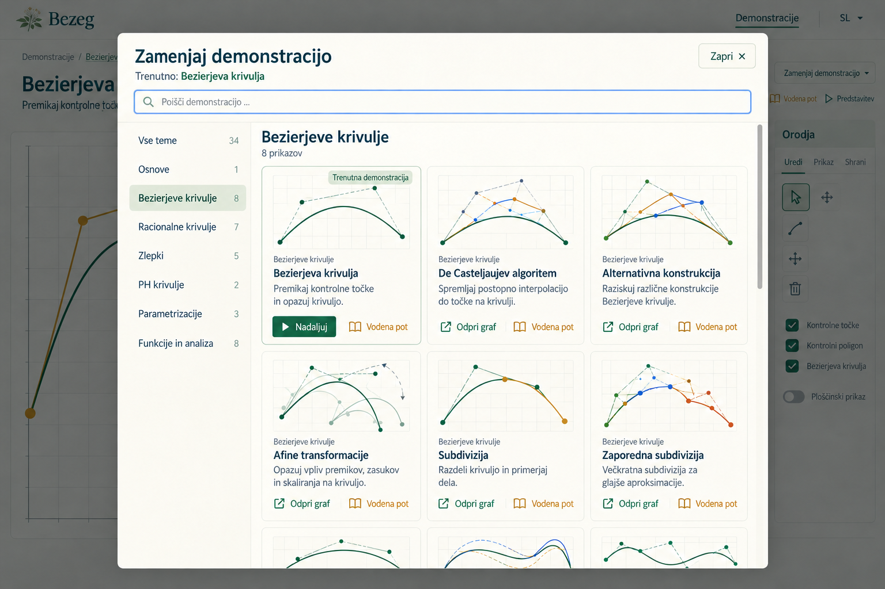
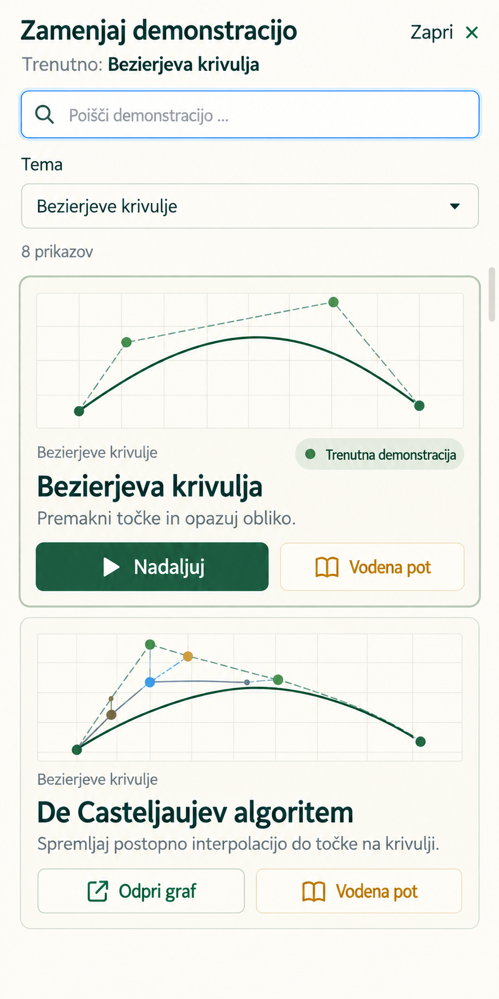

# Demonstrations library and focused workspace

**Status:** implemented locally on 2026-10-15; verification and remaining device/hosting gaps are recorded in [the implementation review](../reviews/demonstrations-library-redesign.md). Originally synthesized on 2026-10-15 at the owner's request using to-spec. This document replaces the earlier proposal in place. It specifies the revised overview-to-experiment direction; the subsequent owner request authorizes application implementation. The owner confirmed route-level user-flow tests plus real-browser verification as the intended test boundaries.

## Problem Statement

Students and educators need a clear way to find a Demonstration, understand what they can investigate, and move into mathematical exploration. Following the homepage carousel relocation, the dedicated catalogue initially shows one Bernstein card inside a wide Osnove panel, while the other families are collapsed. This hides the collection's breadth and gives the page an uneven composition.

The first library proposal improved discovery with search, topic navigation, and visible graph cards. The owner identified a second problem: its sidebar resembles the active workspace's topic tree, although the proposed sidebar filters cards and the current tree expands graph-navigation links. Users would move between similar-looking interfaces with different behaviour.

The collection and the active experiment need distinct purposes, with a consistent selection experience connecting them. Browsing another possibility must not discard the graph or Guided lesson a learner is currently using.

## Solution

Provide a connected flow with two primary views and one shared selection interface:

1. **Choose a Demonstration.** The dedicated catalogue shows search, topic filters, and a continuous grid of graph previews. Each card identifies its family, names the Demonstration, explains one investigation, and offers graph and supported Guided lesson entry.
2. **Explore its mathematics.** The active workspace gives its width to one graph and its tools. Remove the permanent global topic tree. A compact breadcrumb identifies the collection, family, and current Demonstration; returning to the collection restores the learner's browsing context.
3. **Choose again when needed.** A compact “Zamenjaj demonstracijo” action opens the same selection interface in an accessible modal picker. Learners can browse and cancel while retaining their active experiment. Choosing a destination performs ordinary graph or lesson navigation.

The catalogue and picker use the same filtering and entry rules. Existing direct Demonstration and Guided lesson links remain available for educators and returning learners.

## User Stories

1. As a first-time student, I want to see the range of Demonstrations immediately, so that I can find something interesting without opening every topic.
2. As a student unfamiliar with construction names, I want a graph preview and a concrete investigation sentence, so that I can understand what a Demonstration offers.
3. As a student browsing a small family, I want its entries to use the same card layout as other entries, so that one card does not occupy an oversized section.
4. As a student, I want to filter the collection by mathematical family, so that I can compare related Demonstrations.
5. As a student, I want an all-topics choice, so that I can broaden my exploration again.
6. As a returning learner, I want to search titles, families, and investigation copy, so that I can find a named construction or concept quickly.
7. As a Slovenian learner, I want forgiving search for capitalization and diacritics, so that typing a familiar term is sufficient to find it.
8. As a learner, I want to see my active filters and result count, so that I understand which part of the collection I am viewing.
9. As a learner with no search results, I want useful clearing actions, so that I can recover without guessing what went wrong.
10. As a learner, I want to open a graph from its preview, title, or graph action, so that its primary destination is easy to discover.
11. As a learner seeking an explanation, I want a separate Guided lesson action where one is supported, so that I can begin with instruction.
12. As a learner, I want previews to match the Demonstrations they advertise, so that choosing from a picture is trustworthy.
13. As an educator, I want topic counts and stable catalogue ordering, so that I can orient a class efficiently.
14. As an educator, I want to share a filtered collection link, so that students can open the intended selection without an account.
15. As an educator, I want existing direct graph and lesson links to keep working, so that classroom materials remain useful.
16. As a learner entering a graph, I want a focused workspace with a prominent graph, so that browsing controls do not compete with mathematical work.
17. As a learner, I want a breadcrumb naming the collection, topic, and current Demonstration, so that I know where I am.
18. As a learner, I want to return to my previous catalogue filters and position, so that exploring one graph does not lose my place.
19. As a learner arriving from a direct graph link, I want a useful collection destination, so that I can discover related mathematics without previous browsing history.
20. As a learner, I want to request another Demonstration from the workspace heading, so that switching remains easy without a permanent navigation tree.
21. As a learner opening the picker, I want my current family and Demonstration identified, so that I can start from familiar context.
22. As a learner, I want topic selection to filter cards everywhere, so that the same interface has the same meaning.
23. As a learner, I want to browse and cancel the picker without resetting my edited graph, so that looking at alternatives is reversible.
24. As a learner, I want to cancel without losing my selected curve, board view, or draft controls, so that I can continue exactly where I was working.
25. As a learner in a Guided lesson, I want picker cancellation to preserve my frame, scene, and entry checkpoint, so that browsing does not interrupt the lesson's restore behaviour.
26. As a learner watching a construction animation, I want browsing to pause it safely, so that mathematical state does not advance behind the picker.
27. As a learner selecting another destination, I want a single clear navigation, so that duplicate graphs or overlapping lessons do not appear.
28. As a learner selecting the current graph, I want to continue my existing workspace, so that I do not accidentally reset my work.
29. As a keyboard user, I want to reach every filter and entry action with visible focus, so that I can browse without a pointer.
30. As a keyboard user opening the picker, I want focus contained inside it and returned on cancellation, so that I remain oriented.
31. As a screen-reader user, I want the picker, current Demonstration, selected topic, and results identified, so that collection state is understandable.
32. As a touch user, I want comfortable controls and a labeled topic selector on narrow screens, so that every family remains reachable.
33. As a learner using enlarged text, I want titles and actions to wrap without clipping, so that content stays readable.
34. As an English-language user, I want the same flow and translated purpose copy, so that language does not change the available experience.
35. As a learner switching language, I want my graph and navigation context preserved, so that translation does not reset my work.
36. As an educator projecting Bezeg, I want readable previews and a spacious active graph, so that the class can recognize the mathematical idea.
37. As a Presentation mode user, I want the picker to remain usable and cancellation to restore my presentation context, so that switching does not require hover or exiting presentation first.
38. As a learner who prefers reduced motion, I want the same clear flow without required animation, so that navigation remains comfortable.
39. As a learner using browser Back and Forward, I want meaningful collection and graph history, so that navigation behaves predictably.
40. As a contributor, I want one collection implementation and one catalogue data source, so that adding a Demonstration does not create inconsistent page and picker lists.

## Implementation Decisions

### Collection and card ownership

- Share a collection presentation and selection model between the dedicated catalogue page and workspace picker. Host-specific concerns are limited to URL/history integration, return context, dialog behaviour, and closing/navigation callbacks. Do not duplicate cards or maintain a second route, family, lesson-availability, or preview registry.
- Continue using the existing Demonstration catalogue, family identities, teaching order, route-default preview map, and reviewed-lesson availability. Counts are derived; seven families and 34 Demonstrations describe the inspected baseline, not permanent constants.
- A fresh unfiltered catalogue visit shows all Demonstrations in one continuous grid, preserving their existing metadata order. Family labels provide context without per-family rows, empty grid slots, or disclosure panels.
- On wide screens use a persistent topic column and up to three comfortable card columns. Reduce columns when content needs more room. At narrow widths use a labeled topic selector and one card column; do not make a horizontally scrolling topic strip the only access to later families.
- Each card contains its real static preview, family label, existing title, one concise investigation sentence, and compact graph and available Guided lesson actions. Reuse suitable localized prompts; replace generic prompts with specific, mathematically reviewed Slovenian and English copy where necessary. No new lesson content is implied.
- Preview and title lead to the graph. The separate lesson action leads to the existing supported lesson destination. Use distinct accessible names including the Demonstration title and avoid nested links or an interactive card enclosing other interactive controls. Mark decorative preview images appropriately.
- Retain visible action labels, the green graph/ochre lesson distinction, and restrained ghost styling. Preserve the elderflower identity and existing logo. Quiet page decoration and use light card boundaries; mathematical previews remain the main visual evidence.

### Filtering, URLs, and return context

- Share one filter contract: all topics or one existing family, combined with a text query. Search localized title, family name, and investigation copy. Trim surrounding whitespace and match case- and diacritic-insensitively. Match all whitespace-separated query terms across those fields; preserve the user's entered text in the input. Fuzzy search, translated aliases from the inactive language, and formula parsing are excluded.
- Show the active topic and result count, with separate clear-query and all-topics actions. No results must explain the active constraints and offer clearing the query or broadening the topic. Topic counts describe the full family; the result count describes the combined filter.
- Use the existing catalogue route with optional `topic` and `q` query parameters. `topic` is a URL-encoded existing family identity; omission means all topics. `q` is the search text; an empty query is omitted. Unknown topic values fall back to all topics and never produce a route error. Retain unrelated query parameters and the hash when changing these filters.
- Typing replaces the current catalogue history entry rather than adding one entry per keystroke. Explicit topic selection and clear actions create navigable history entries. Back and Forward restore controls and results from the URL.
- Keep return context in app-owned, visit-scoped navigation state: validated internal catalogue location, a stable visible-card anchor/scroll position, and a focus target. Do not accept an arbitrary external return URL or put this context into Presets. In-app graph and lesson entry retain the originating catalogue context across later switches.
- Browser Back and the workspace's collection breadcrumb/header link return to the originating collection filters and position. Restore the originating card's focus when possible. Clamp scrolling or use the nearest available card if a translated or changed result set affects layout.
- Direct graph arrivals with no catalogue context return to the unfiltered catalogue at its start. The family breadcrumb separately opens that family's filtered catalogue. A direct shared catalogue URL reconstructs filters after refresh; scroll/focus restoration is a visit convenience, not cross-device persistence.
- A language change translates the UI and recomputes matching in the selected language while retaining the entered query and selected family. It does not recreate the active graph or overwrite edited geometry.

### Focused workspace and picker

- Remove the permanent global family tree from the shared workspace. Give the graph and existing inspector the available width. Retain the graph's controls, Exploration prompts, Guided lesson entry, Presentation mode, and mounted Uredi/Prikaz/Shrani sections.
- Keep a compact breadcrumb for collection, family, and current Demonstration; the current item is non-interactive and identified as current. The workspace heading contains a labeled switcher, “Zamenjaj demonstracijo” in Slovenian, with its English counterpart.
- Each picker opening starts with the current family and an empty query. Identify the active Demonstration separately from keyboard focus and selected topic. Browsing in the picker does not rewrite the graph URL, add history entries, or overwrite the standalone catalogue's return context.
- The picker uses the same collection cards, filters, ordering, and graph/lesson destinations as the page, adapting columns to the available dialog width. Selecting a topic always filters cards. It does not directly replace the graph.
- At desktop widths, use a centered modal over a dimmed but recognizable active workspace. Keep its title, current-Demonstration context, search, and close action available while results scroll; keep topic navigation available beside the results. At narrow widths, make the picker fill the viewport, replace the topic column with a labeled selector, and use one card column. Use a compact dialog heading without a second app-brand masthead. Search/topic controls and close must remain reachable when screen height or a virtual keyboard reduces the available space; allow the controls to scroll if pinning them would leave no usable results area.
- Keep the active graph host, board, auxiliary boards, controls, selection, view, and lesson session mounted while the picker is open. Do not serialize into a Preset, import a scene, reset a lesson, or recreate geometry to implement cancellation.
- Pause active graph-owned playback at its current frame before exposing the picker, through its owner. Leave it paused on cancellation, with existing playback controls available to resume deliberately. Preserve mathematical state and lesson position; do not use a destructive scene-reset command as a pause. This narrow integration does not authorize an animation-system rewrite.
- The picker is the sole active modal while open. Make the underlying workspace, global header, and any lesson presentation non-interactive and unavailable to keyboard focus. Retain the lesson session, checkpoint, current frame, explanation/observation mode, and Presentation mode beneath it.
- Provide a visible close action and Escape cancellation. Place initial focus on the search field, contain Tab navigation, prevent background scrolling, and restore focus to the switcher on cancellation. A click outside need not dismiss the picker. Search-result changes must not steal focus; use a concise result announcement without reading every card.
- Choosing the current graph closes the picker and resumes the existing workspace state, including an already active lesson, without resetting it. Choosing its Guided lesson resumes the active lesson if present or starts it through the existing entry flow on the same graph. Starting a lesson must retain the normal pre-lesson capture/Exit-restore contract.
- Choosing another graph or available Guided lesson closes the picker and performs one normal route navigation. The previous owner disposes its boards, listeners, timers, animation, and lesson session through existing lifecycle boundaries. Do not promise recovery of unsaved edits after an actual route switch.
- Switching demonstration within Presentation mode retains Presentation mode; cancelling always retains it. The picker must fit and scroll independently without making essential actions inaccessible. Retain the existing explicit presentation tools/exit controls.
- Block opening the picker while the graph is in an existing busy scene-replacement or export operation; expose the temporarily unavailable action accessibly. Do not start parallel operations or bypass existing language/export locks.

### Constraints and documentation

- Keep existing catalogue, graph, and lesson URLs, query/hash behaviour outside the new catalogue filters, Preset formats, stored data, geometry, and static client-only hosting. There is no backend or account requirement.
- Respect existing graph-owned geometry/disposal and typed Guided lesson capabilities. Do not reach into board internals from the collection or reconstruct lesson state in navigation code.
- Use typed localization keys and exact placeholder names in both languages. New module boundaries must not couple mathematical features to app-shell navigation.
- This spec supersedes family-disclosure and permanent-workspace-topic-tree presentation requirements in the earlier catalogue and learning-workspace specifications for this feature. The homepage carousel relocation and its interaction contract remain unchanged. The user-visible change is removal of those two navigation structures in favour of filters and an on-demand picker; no route alias, storage migration, or data reset is required.
- At implementation, update architecture and user-flow/hosting guidance that describes ownership or entry behaviour. Update affected test expectations rather than retaining obsolete disclosure assertions. The unrelated visual-hierarchy draft is not an implementation dependency.

## Acceptance Criteria

1. Fresh catalogue entry shows every current Demonstration in metadata order in a continuous grid, with derived counts and no closed family panels or oversized one-card section.
2. Topic selection, text search, clear actions, empty results, URL refresh, and Back/Forward follow the shared filter contract. Shared filtered URLs work on direct entry.
3. Every card has its faithful preview, family, title, useful localized investigation sentence, graph entry, and only its supported lesson entry. All existing destinations remain reachable.
4. The focused workspace contains a prominent graph, existing tools, breadcrumb, and switcher, with no permanent global family tree.
5. Full-page and picker collection controls have consistent meaning and results for the same language, topic, and query. A picker starts at the active family and identifies the current Demonstration.
6. Opening, filtering, and cancelling the picker preserve graph/board identity, edited geometry, selection, view, draft controls, lesson state/checkpoint, and Presentation mode. Any running playback pauses at its current frame and remains paused on cancellation.
7. Selecting the current graph does not reset it. Current-graph lesson entry preserves normal lesson capture/restore behaviour; selecting another destination navigates once and cleans up the previous owner.
8. Returning to the catalogue restores its filters and browsing position/focus where valid. Direct graph arrivals receive the documented catalogue fallback without relying on prior app history.
9. Picker keyboard focus, Escape/close, background isolation, result announcements, scroll containment, and focus restoration work. Graph input and lesson controls cannot respond behind the open picker.
10. Slovenian and English, 390/724/1440 CSS-pixel layouts, enlarged text, and reduced motion retain readable content, reachable actions, and no document-level horizontal overflow. Physical touch and classroom projector review are reported separately from browser emulation.
11. Presentation mode, busy/export locks, direct lesson arrivals, lesson explanation/observation/completion, repeated switching, and language changes remain operable without duplicated or leaked boards/listeners.
12. Appropriate route/workspace tests, TypeScript, production build, browser workflows, and required documentation updates pass or report explicit failures and incomplete coverage before implementation is declared complete.

## Testing Decisions

The owner confirmed the primary boundary on 2026-10-15: route-level user flows plus real-browser checks. Prefer existing router/component integration seams and the production browser harness. Do not add a separate filter-service test framework or tests that merely mirror implementation details.

| Boundary | Required observable evidence | Existing prior art |
| --- | --- | --- |
| Catalogue route with shared collection | All metadata entries/order, family and combined search filtering, normalization, counts, clearing, empty results, unavailable lessons, current marker, both languages, query/hash and malformed-topic fallback | Dedicated catalogue route tests, metadata/preview-map checks, app-header navigation tests |
| Router flow into and out of workspace | Graph/lesson destinations, current-route selection, URL history, return filters/scroll/focus, direct-arrival fallback, filtered refresh, no graph navigation while only browsing the picker | Existing memory-router catalogue/deep-link/error tests and shared app route tests |
| Shared workspace and lesson entry | Cancel preserves mounted draft controls and host identity; current graph does not reset; current lesson resumes; lesson start captures and Exit restores the pre-lesson scene; busy and Presentation mode behaviour | Workspace control-retention/language/presentation tests and Guided lesson session/runtime tests |
| Production browser | Real edited points and selected curve survive picker open/filter/cancel; animation pause at current frame; focus trap and background isolation; scroll restoration; PH auxiliary boards and repeated route disposal | Catalogue, ownership, workflow, and data-driven Guided lesson browser suites |

Good tests operate controls, follow links, and observe URLs, rendered results, mathematical state, focus, and resource lifetime. Avoid exact CSS values, component decomposition, generated-image pixels, fixed counts that duplicate metadata, or exposing private implementation state solely to assert it. Real board identity/lifetime inspection through the existing browser harness is appropriate for proving absence of remounts and leaks.

For implementation verification:

- Extend or replace affected catalogue and workspace interaction tests at their existing seams. Keep unrelated homepage carousel coverage. Include malformed/encoded filter values, diacritic-insensitive terms, zero results, current-target selection, a lesson-unavailable entry, and restoration after switching families.
- Use the existing data-driven lesson suite for representative lesson integration; do not rewrite lesson prose or weaken mathematical-notation tests. Exercise explanation, observation, animation, completion, Exit restoration, and repeated picker cancellation.
- Run the relevant established unit/integration scripts, typed-localization checks, `npx tsc --noEmit --pretty false`, and the production build. The build does not replace TypeScript checking.
- Run the smoke-tester workflow and the full shared-workspace browser checklist because navigation presentation changes across every Demonstration. Add the changed catalogue/picker flows and account for every selected check as passed, failed, blocked, or skipped.
- Verify production catalogue and graph deep links, refresh, filtered query URLs, lesson query/hash preservation, assets, unknown-route behaviour, and browser history. Distinguish local production-preview evidence from hosted GitHub Pages evidence.
- Review 390, 724, and 1440 CSS pixels in both languages, enlarged text, reduced motion, keyboard, touch-sized targets, and Presentation mode. Inspect card copy/previews and a normal workspace plus an open picker. Check reduced viewport height and, where device/browser tools permit, the mobile virtual keyboard with search focused; report missing physical-device coverage. The static mockups do not prove these properties.
- Keep mathematical algorithms and generated previews unchanged. Use before/after numeric scene values to verify preservation; if implementation touches evaluation, construction, animation semantics, or scene restoration, add the relevant mathematical and lifecycle checks for the actual changed operations.
- Review the resulting multi-file feature with parallel reviewers for engineering/ownership, mathematical preservation, and UI/accessibility under the repository workflow. Implementation delegation and evidence capture follow the existing workflow; no workers are dispatched by this spec-writing task.
- Record checkout/build provenance, commands, browser observations, cleanup, known failures, and remaining physical-device/projector gaps. Documentation-only specification work needs no app build or browser smoke run.

## Out of Scope

- New prototype design work beyond the supplied visual references.
- Homepage/carousel redesign, new Demonstrations, new Guided lessons, curriculum paths, or lesson prose changes beyond catalogue investigation copy.
- A permanent combined catalogue/graph/tools dashboard, a second topic tree in the workspace, pagination, favourites, difficulty labels, invented durations, accounts, progress dashboards, or cross-device synchronization.
- Recovering unsaved scenes after actual graph navigation, persistent browsing preferences, automatic graph-state backups, or new Preset/file formats.
- Renderer, build-tool, UI-library, numerical-algorithm, preview-generation, or animation-engine migrations; new performance claims without measurements.
- A new logo, generated mathematical production artwork, mandatory animated card-to-graph morphing, or generic search infrastructure.

## Visual References

Use these three views together with the written contracts. They establish visual hierarchy and the relationship between collection, workspace, and picker; they are not pixel specifications or assets to ship in the application.

| Reference | What it establishes |
| --- | --- |
| [Catalogue to focused workspace](../prototypes/demonstrations-library-flow.png) | A collection for choosing, then one spacious graph and its tools; the active workspace has no permanent global topic tree. |
| [Open desktop picker](../prototypes/demonstrations-library-picker-desktop.png) | A centered modal over the retained workspace, dimmed background, current-Demonstration marker, visible close/search, topic column, and scrollable card results. |
| [Open narrow-screen picker](../prototypes/demonstrations-library-picker-mobile.png) | A full-viewport picker, compact heading and close action, labeled topic selector, one card column, and distinct current-graph continuation and lesson actions. |

The written specification takes precedence when generated details differ. In particular, use existing logo, Demonstration titles and teaching order, metadata-derived counts, supported lesson actions, faithful preview assets, and existing inspector controls. Keep the specified compact ghost action treatment; generated filled/outlined buttons are illustrative. Do not infer extra card entries from cropped continuation rows. The current-Demonstration badge is not a claim that the keyboard focus is on that card: initial focus is on search. Exact dimensions and pinning must adapt to real content, translation, enlarged text, and usable viewport height.

These images were generated with built-in ImageGen, inspected, and revised for matching active-workspace context and a compact mobile heading. [The prompt record](../prototypes/demonstrations-library-picker-prompts.md) preserves their generation and correction instructions. They do not demonstrate focus containment, background inertness, animation pause, state retention, real keyboard fit, or board disposal; the testing requirements remain necessary.

## Further Notes

- This document is the canonical specification for the conversation. The owner requested synthesis without another design interview. Detailed search, URL, current-target, focus, and playback-pause rules above resolve routine implementation ambiguities; they are specification decisions, not claims of completed implementation or user-tested behaviour.
- Design evidence: the deployed catalogue and Bernstein workspace were inspected on 2026-10-15 and compared with their route and shared-workspace components. The owner liked the initial library direction and raised the conflicting-sidebar concern; the revised design removes the active workspace's permanent tree.
- The overview-to-experiment and open-picker studies are recorded under Visual References above. Generated graph marks, formulas, wording, proportions, and branding details are illustrative placeholders. Existing metadata, reviewed previews, logo, and graph mathematics remain authoritative.
- The open picker's real layout, layered lesson interaction, and animation-pause integration require implementation-time visual and behavioural validation. Use the existing prototype workflow if a runnable exploration is needed; do not treat an untested mockup as acceptance evidence.
- Related guidance: [homepage/catalogue ownership](homepage-carousel-and-demonstrations-catalogue.md), [learning workspace](learning-workspace.md), [browser checklist](../smoke-tests.md), [localization](../localization.md), [static-client constraint](../adr/0001-static-client-only-app.md), [typed graph capabilities](../adr/0002-guided-lessons-static-content-and-graph-capabilities.md), [graph-anchored lessons](../adr/0003-frame-based-graph-anchored-lesson-overlay.md), and [graph ownership](../adr/0006-model-input-ownership-before-renderer-migration.md).
