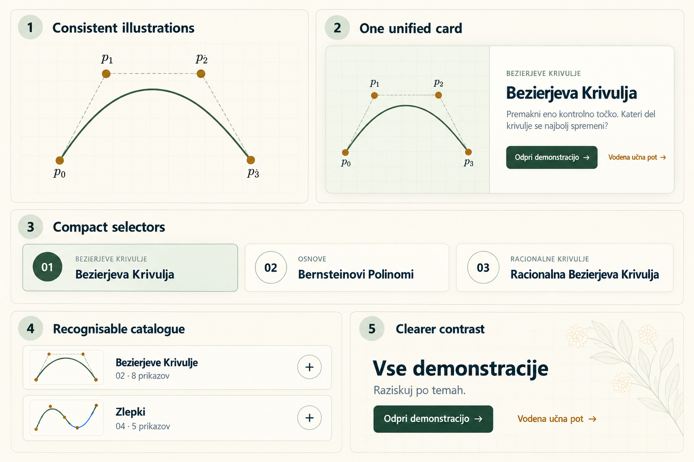

# Compact starting choices and recognisable topic headers

**Status:** specified for implementation; no app implementation in this change. Selected by the owner on 2026-10-14 from the Demonstrations visual review and image prototypes.

Placement update (2026-10-15): the confirmed [homepage-carousel and catalogue brief](homepage-carousel-and-demonstrations-catalogue.md) supersedes this document's requirement to preserve page composition and carousel placement. Compact choice tiles travel with the carousel to the homepage; family thumbnail/title grouping stays in the catalogue. Other component-refinement decisions remain in force.

## Problem Statement

The owner likes the Demonstrations page placement and opening carousel. Two details make browsing harder than it needs to be: the starting-choice tiles have excess empty space below small labels, and the conceptual family thumbnails sit far from their titles at the right of the catalogue headers. Learners should be able to identify a starting Demonstration or mathematical family quickly, including during classroom projection.

## Solution

Keep the existing page composition and interactions. Make the starting-choice strip more compact, with clearer title hierarchy, and place each existing family illustration directly before its title in the catalogue header. Retain the elderflower palette and current selected/expanded styling.

## Image examples

- **Panel 3, Compact selectors:** use the tight vertical spacing, prominent Demonstration title, quieter family label, and selected numbered badge as the visual target. The three examples are an enlarged component sample, not a reduction of the six available choices. Keep the current single-line, internally scrolling strip. The production labels remain on one line with ellipsis when needed; do not copy the wrapping in other generated page previews or shrink text to fit every tile onscreen.
- **Panel 4, Recognisable catalogue:** use the thumbnail/title/count grouping on the left and the disclosure mark at the far right. Apply it to all families, expanded and collapsed. The same header remains one disclosure button.
- Panels 1, 2, and 5 provide context only and are **not authorised implementation scope**. In particular, do not restyle mathematical illustrations, the hero card, page decoration, or the global contrast system from this sheet.
- This is a generated image prototype, not a screenshot of implemented behaviour. Its text, curve drawings, dimensions, counts, and colours are illustrative. Existing metadata, translations, family SVGs, and route-default preview assets remain authoritative. Do not ship the sheet or extract its drawings as UI assets.

## User Stories

1. As a learner, I want the starting choices to occupy less vertical space, so that the carousel feels concise and the catalogue is easier to reach.
2. As a learner, I want each Demonstration title to lead its family label, so that I can scan the available choices quickly.
3. As a learner, I want the active tile and numbered badge to remain obvious, so that I can connect my selection to the featured preview.
4. As a learner, I want all six choices to remain available, so that visual refinement does not narrow the starting options.
5. As a touch user, I want to scroll the strip and activate a comfortable target, so that compactness does not make selection harder.
6. As a keyboard user, I want visible focus and the existing arrow-key navigation, so that I can choose a Demonstration without a pointer.
7. As a screen-reader user, I want complete choice names and selected state, so that visual truncation does not hide information.
8. As a learner browsing topics, I want the family picture beside its name, so that I recognise the topic as one visual group.
9. As a learner, I want the family count below the title and the disclosure mark at the far right, so that the header has a predictable hierarchy.
10. As a learner, I want any part of the topic header to toggle its panel, so that the picture does not become an unexpected separate action.
11. As an educator, I want readable titles and recognisable family pictures, so that I can introduce topics on a projected desktop view.
12. As a user of either Slovenian or English, I want long names to fit safely, so that language switching does not crowd or overlap controls.
13. As a learner who prefers reduced motion, I want the existing manual carousel experience preserved, so that these refinements introduce no new movement.

## Acceptance Criteria

1. At normal text size, choice tiles have a consistent, visibly reduced height compared with the current 92px desktop / 84px narrow minimums. Aim for roughly 68–76px overall height, adjusting padding for the existing box model. Treat this as a design target, not a fixed cap when text is enlarged. There is no large unused lower area.
2. Demonstration titles are at least 14px at default zoom, bolder and more prominent than the family labels. Family labels remain legible; do not solve crowding by reducing them below their existing size. Number badges remain aligned with the copy. Selected fill, border, and filled badge clearly identify the active tile independently of focus.
3. All six tiles remain in one horizontal strip at 390, 724, and 1440 CSS pixels. Internal overflow and a partial next tile are acceptable and intentional; document-level horizontal overflow is not. Do not require all six to fit simultaneously. Full accessible names and existing title tooltips survive ellipsis.
4. Every topic header visually reads left to right as thumbnail, title with sequence/count beneath, then a trailing disclosure mark. Images retain their aspect ratio and complete drawing. Use roughly the current thumbnail sizes or a modest increase where space allows; at narrow widths retain space for the longest family names to wrap without obscuring the mark.
5. Each header remains a single full-width button, including its picture and text. Its accessible name comes from the family name/count; decorative images have empty alternative text and no independent focus target. Expanded state, controlled region, independent disclosure operation, and hidden-panel focus exclusion remain correct.
6. Tiles and disclosure buttons retain at least 44×44px activation areas, visible unclipped keyboard focus, and usable layouts with enlarged text. Hover, selected, expanded, and focused states remain distinguishable.
7. Existing six-second carousel advancement, temporary pauses, manual takeover, reduced-motion handling, selected preview/actions, family order, initial expansion, and graph/Guided lesson destinations behave as before. No routes or stored Presets change.
8. Slovenian and English versions pass the same layout checks, including the long rational-family labels. No new copy or translation keys are expected.

## Implementation Decisions

- Refine the existing opening-carousel choice markup/styles and catalogue family-header markup/styles. Reuse their data and state; no new component API, navigation model, test seam, or dependency is needed.
- Confine typography overrides to choice tiles. The family-label style is shared with the featured card, so selector adjustments must not change hero typography accidentally.
- Keep tile copy flexible and capable of shrinking within the row; use appropriate tile widths and ellipsis instead of forcing all six choices into the available page width. Preserve the established one-line choice-label policy.
- Reposition the existing conceptual family illustrations before the title group inside the disclosure button. Reserve a stable thumbnail slot, let the title group use remaining width, and keep the mark from shrinking. Preserve natural reading order and existing disclosure semantics.
- Reuse family SVGs. This change does not regenerate route-default previews, change coordinate context, or mount mathematical boards in the catalogue.
- These two decisions supplement the existing carousel, expandable-catalog, and visual-refinement specifications. They take precedence only for choice-tile density/typography and family-thumbnail placement. Broader hierarchy work is separate and is not implied by the attached sheet.

## Testing Decisions

- Use the existing Demonstrations route/component seam as the single primary seam. Existing page tests already exercise carousel timing, manual takeover, reduced motion, selection/destinations, and disclosures; retain that coverage. Add tests only for observable behaviour a markup change puts at risk, not CSS values or exact DOM ordering.
- Extend or use the existing Demonstrations browser suite for layout evidence. Review all six choices and all seven family headers at 390, 724, and 1440px in both languages, expanded and collapsed. Confirm internal rail scrolling, long-name handling, loaded thumbnails, focus visibility, and no page overflow. Review representative enlarged-text and projection-scale views.
- Exercise pointer selection, narrow-width swiping, keyboard Tab/Left/Right/Enter/Space, and activation from the thumbnail area. Check that disclosure images introduce no extra focus stop and controls retain their complete accessible names/states.
- Run the focused page tests, TypeScript check, and production build using current package scripts. Use the smoke-tester focused browser-validation lane and the repository browser checklist for the affected Demonstrations workflow, including a graph destination and an available Guided lesson destination. The shared workspace and lesson runtime are unchanged; full-app smoke coverage is unnecessary for this bounded change.
- Record before/after component screenshots, commands/results, browser viewport evidence, and incomplete coverage. A good check demonstrates that the choices are more compact and topic images sit beside their titles while selection and disclosure remain usable. Avoid tests that merely repeat style declarations.
- No new geometry checks or preview-generation tests are required unless implementation exceeds this scope. This documentation-only commit does not require app tests or browser smoke testing.

## Out of Scope

- The other three suggestions: illustration art direction, unified hero surfaces, and a page-wide contrast pass.
- New artwork, altered mathematical content, preview capture changes, or graph-workspace styling.
- Changes to carousel timing, scrolling policy, selection behaviour, family grouping/order, route destinations, lessons, Presets, or persistence.
- Search, filters, expand-all, new controls, global typography migration, or forcing every selector into one desktop viewport.
- Implementing the app changes or creating an implementation task breakdown in this documentation request.

## Further Notes

- Source: the 2026-10-14 conversation reviewing the live Demonstrations page, followed by a full-page mockup and a five-panel component sheet. The owner selected the two strongest recommendations for specification.
- Related context: [opening carousel](demonstrations-opening-carousel.md), [expandable catalogue](expandable-demonstration-catalog.md), and [visual refinement](demonstrations-visual-refinement.md).
- The attached sheet was generated with the built-in image tool and is stored with this spec so an implementer does not depend on chat history or a personal generated-images directory. No implementation task has been created.
