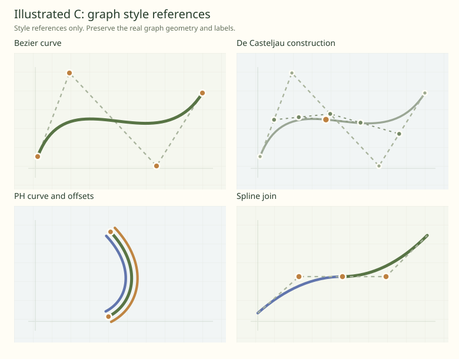

# Graph visual style: illustrated C direction

## Owner request and source

The owner liked the illustrated Variant C prototype and wants the actual interactive graphs to adopt its visual language. They explicitly rejected illustrations whose geometry did not match the demonstration: improve presentation while preserving mathematical meaning. Production catalog C is commit `d0ca083`; its per-demonstration images now capture real starting scenes. This task is the separate follow-up to [the catalog implementation](../reviews/interface-implementation-history.md#dedicated-catalogue-and-topic-presentation).

The visual reference is the original illustrated C at commit `c6a2155` on `codex/prototype-demonstration-motion`, especially `src/DemonstrationPreview.prototype.tsx` and the `.dcp-svg-*` rules in `src/DemonstrationsCatalog.prototype.css`. The prototype is an archived design source, not production code to import. Its hand-picked curves/settings are illustrative and must not replace graph defaults or evaluation.

These portable SVG examples were exported from that commit. They demonstrate color, hierarchy, stroke treatment, control markers, and quiet backgrounds. They deliberately omit much of the real board's notation; that omission is not permission to remove labels or teaching constructions from the app.

## Outcome and scope

Restyle the existing JSXGraph graphs to feel calm, clear, and consistent with Bezeg's elderflower identity. Cover every current demonstration family, including function graphs and PH auxiliary boards. Start with a bounded pilot on ordinary Bezier, De Casteljau, rational Bezier, and cubic PH, then extend the reviewed shared treatment across the remaining routes. Derive coverage from current `src/demonstrations.ts`; at specification time it contains 29 demonstrations in seven topics.

Keep the renderer, numerical algorithms, curve samples, routes, default points/settings, construction visibility, coordinate bounds/fit behavior, lessons, controls, presets, and board ownership unchanged. Changing appearance is authorized; changing an example's geometry to make it prettier is outside scope. Do not add runtime thumbnail boards, animation decoration, a settings page, or a new design-system dependency. A discovered lifecycle or geometry bug belongs in a separate bounded fix rather than an opportunistic migration.

## Visual direction

Use the following reference palette as a starting point. Tune contrast and line widths for the real board, classroom projection, dark labels, selection, and exports; the small SVG's pixel sizes and low opacities are not production specifications.

| Role | Prototype reference | Intended treatment |
| --- | --- | --- |
| Board surface | sage `#f5f7ef`, cream `#fffdf5` | Quiet warm background that fits the app; a subtle grid when the existing grid mode allows it |
| Primary curve | moss `#587445` | Strongest continuous line, smooth round caps/joins where supported |
| Comparison curve | slate blue `#6175ad` | Clearly distinguishable second curve without neon colors |
| Secondary geometry | sage `#9aa695`, muted control lines `#a8b39c` | Lighter/thinner than the curve; dash patterns where appropriate to a control polygon |
| Construction accent | amber `#bf8542` | Distinguish active interpolation or selected construction without overwhelming the final curve |
| Control points | ochre `#bd8040`, cream outline | Clear, consistent markers; keep editable and fixed/derived roles distinguishable |
| Axes and grid | muted green-gray | Lower visual emphasis than mathematical content, but still readable and faithful to axes/tick/grid toggles |

Treat colors as roles rather than globally replacing the indexed `Colors` array. Its entries may distinguish independent curves, construction levels, selected objects, or terms in lesson prose. Audit those meanings before mapping colors. Preserve distinctions using labels, marker styles, line styles, or brightness as well as hue. Multi-curve graphs must remain distinguishable beyond the first two colors.

Labels are part of the diagram. Retain exact symbols, indices, superscripts, values, and MathJax typesetting. Improve consistent anchoring/spacing and avoid avoidable collisions with points or curves, especially De Casteljau's stacked labels; never change point coordinates or hide required notation to clear a collision. Keep size controls and presentation mode useful. Selection/hover must remain visible without changing curve geometry, enlarging visible markers into a distracting motif, or making drag hit targets harder to use.

## Concrete examples

| Demonstration | Change to make | Preserve |
| --- | --- | --- |
| Ordinary Bezier `/bezeg-2.0/bezier/curve` | Use a confident moss curve, restrained dashed control polygon, outlined ochre control points, quieter axes/grid, and well-spaced dark labels. See [Bezier reference](../images/graph-visual-style/bezier.svg). | The actual default control points and curve shape; polygon/point/label toggles; drag, selection, coordinate editing, and zoom/fit behavior |
| De Casteljau `/bezeg-2.0/bezier/decasteljau` | Give the final curve the strongest emphasis; make interpolation levels readable with a small ordered palette and lighter line weights, and emphasize the current result with an accent marker. See [construction reference](../images/graph-visual-style/decasteljau.svg). | Every currently visible construction level and its exact labels; the real value of t, slider/animation response, and lesson scenes |
| Rational Bezier `/bezeg-2.0/rational/base` | Apply the same curve/point hierarchy and calm weight/derived-point styling where those objects are present. | Current weights, rational evaluation, weight controls, poles/unsupported cases, and distinctions between free and derived points |
| PH cubic `/bezeg-2.0/ph/cubic` | Keep the base curve dominant; style existing visible offsets as lighter but distinct curves. Give the generating-point/hodograph board the same label and marker conventions. See [PH reference](../images/graph-visual-style/ph-cubic.svg). | Offset distances/counts and visibility, normal constructions, orientation, generating points, and all auxiliary-board interactions; do not enable offsets solely for appearance |
| Spline C1 `/bezeg-2.0/spline/c1spline` | Show a clear shared curve rhythm, quieter handles, and a legible join/continuity distinction. See [spline reference](../images/graph-visual-style/spline-c1.svg). | All pieces, knot/join locations, exact continuity constraints, handle dependencies, and current labels |
| Functions `/bezeg-2.0/functions/trigonometric` | Use coordinated distinguishable function colors with readable labels/legend and quiet axes; retain enough contrast to follow crossings. | The displayed functions, parameters, period/amplitude/phase, scales, domains, and mathematical distinctions; no decorative Bezier shape substitutions |

The references use different illustrative geometry from these real route defaults. Compare before/after on the same real scene, including an edited scene, rather than judging resemblance by copying a reference curve's shape.

## Implementation starting points

Inspect `src/graphs/styles/{CurveStyles,PointStyles,SegmentStyles,AxisStyles}.ts`, `src/graphs/context/{SizeContext,VisibilityContext,AxisContext}.ts`, `src/graphs/curves/bezier/utilities/Colors.ts`, `src/JGBox.tsx`, workspace CSS, and graph-specific object/construction styling. Find actual overrides rather than assuming the shared styles reach every family. Reuse a small shared role palette/style seam if it reduces inconsistent overrides; do not refactor evaluation or ownership to achieve styling.

Audit matching colors in lessons and exports. Update explicit color descriptions in Slovenian and English together if the diagram changes their meaning. Keep localization typing and lesson math-notation requirements from AGENTS.md. SVG and PNG exports should retain the intended curve/point/label hierarchy, background/grid behavior, and any existing transparency contract. Do not make only the CSS on-screen board look correct while exported figures lose the treatment.

After the graphs are final, regenerate per-demonstration catalog captures with `scripts/capture-demonstration-previews.cjs` from a production build. Verify the exhaustive image map and manifest. Align starter/family illustration colors if necessary, while retaining their conceptual status and geometry. Do not redesign catalog C again.

## Acceptance and evidence

- Provide matched before/after screenshots for the pilot routes, at the same points/settings/bounds, and representative images for each remaining family. State which objects changed appearance.
- All current routes, lesson states, selected/hovered objects, higher point counts, size controls, and PH auxiliary boards remain usable. Inspect 390px, the owner's 724px intermediate width, desktop, and browser presentation mode; do not claim physical projector/phone evidence without testing it.
- Default and edited scenes retain their points, weights, parameter values, shapes, visible objects, and numerical results. Verify relevant geometry checks if implementation touches anything beyond presentation; don't weaken mathematical or lesson tests.
- Review legibility, label collisions, non-color distinctions, visible selection/focus, and interaction hit targets. Quiet grid styling must honor existing visibility toggles.
- Measure representative dragging and construction/weight/PH sliders before and after on matched production scenes, following [the performance plan](../performance-plan.md). Record enough evidence to detect a styling-related interaction regression; do not start a renderer/performance migration.
- Run TypeScript, relevant tests, and the production build. Use `$smoke-tester` for this multi-family renderer-presentation change with [the checklist](../smoke-tests.md), including graph edits, specialized controls, navigation/lifecycle, language retaining scene, presets, lessons, keyboard/narrow layout, and new export/style checks.
- Inspect downloaded SVG and PNG figures, including typeset labels, and at least one lesson scene restored after exit. Regenerate and review catalog previews against their real default graphs.
- Record changes, evidence, unresolved limits, and source capture provenance here. Update architecture/UI documentation where described appearance changes. Commit and publish completed verified implementation under the repository's normal workflow; this handoff itself changes only documentation.

## Deferred and known issues

No change to curve defaults, evaluation, numerical sampling, renderer, hosting, catalog layout, preset schema, or lesson flow is planned. The prior capture work observed a PH cubic initialization/disposal failure in development StrictMode; production PH cubic/quintic rendered successfully. Treat that as a separate existing diagnosis if encountered, not a reason to hide the route or change ownership in this style task.
## Implementation evidence (2026-10-11)

Implemented from freshly fetched master `d0ca083`, preserving the owner's unrelated checkout changes. Graph source commit `a72af4b` applies shared appearance roles and compact De Casteljau label placement to the actual existing boards. No geometry defaults, evaluation, construction algorithms, routes, lesson content, preset schema, controls, renderer, or figure-export lifecycle changed. Existing blue-left/orange-right subdivision and blue-main/orange-reference function semantics remain.

The [implementation report](../reviews/graph-visual-style/README.md) contains actual matched before/after images for Bezier, De Casteljau, rational, PH with existing offsets explicitly enabled, spline joins, and functions; exact capture/build provenance; mathematical comparison coverage; independent reviews; production, unit, browser, downloaded-export, UI, and performance evidence; and retained limitations. The 29 catalog previews are captured from unmodified default routes after styling and are identified by their graph-source commit in the capture manifest. Concept icons retain their existing geometry.

Measured evidence uses headless Chromium with simulated widths and synthetic mouse input. Physical phone/projector/touch performance and comprehensive accessibility acceptance remain untested. Higher-count or coincident constructions and existing spline join labels can still crowd; this change preserves all notation and does not add a general label-collision solver. The smoke worker's elapsed budget left incomplete coverage, recorded explicitly alongside the handler's completed supplemental checks.
