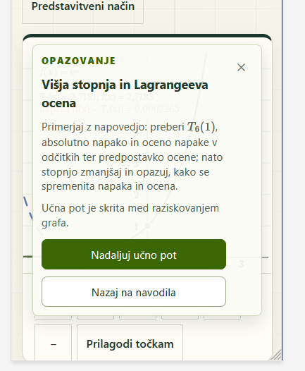

# Keep the graph usable during Guided lessons

**Status:** implemented, published and verified on 2026-10-20 after owner authorization; small lesson tab selected. Acceptance and publication evidence is recorded in the linked task.
**Implementation task:** [Restore graph access](../tasks/lesson-graph-access/restore-graph-access.md)
**Reported:** 2026-10-20
**Related contracts:** [Guided lessons](guided-lessons.md), especially Learner experience; [Standalone learning](standalone-learning.md), especially activity context and narrow screens; [guardrails](../guardrails.md).

## Problem and evidence

The owner supplied this narrow-screen example from the higher-degree/Lagrange-error lesson:

After handing control to graph exploration, the supposedly compact Observation prompt can still cover most of the usable board. It repeats the observation title, full prompt, a hidden-lesson hint, and two large actions. A pointer-transparent wrapper does not make obscured geometry readable or restore pointer access beneath its interactive card. Moving the card is insufficient when it occupies most of the board.

The owner reports that X closes the demonstration. Inspection of the current working tree shows the prompt's shared close button calls `session.close()` and the host close callback: it exits the lesson, rather than providing a reversible way to hide instructions. Confirm the exact host/navigation effect during reproduction; do not assume the screenshot proves a route change.

Relevant implementation starting points: `src/learning/runtime/GuidedLesson.tsx`, `GuidedLesson.css`, and the host in `src/graphs/base/DemonstrationWorkspace.tsx`. Implementation started from `c2c3fcc`; the only existing working-tree change was the unrelated untracked `debug.log`.

## Options to evaluate

| Option | User experience | Trade-off |
| --- | --- | --- |
| Minimize to a lesson tab (recommended first candidate) | A labeled Hide instructions action reduces context to a small tab or workspace action. Open instructions restores the same frame. Continue is separately labeled as advancing the lesson. | Smallest conceptual change; instructions are less visible while exploring. Put the tab outside the plotting area where practical. |
| Responsive dock | Instructions sit beside the graph on wide screens and in a collapsible section below it on narrow screens. The collapsed header opens the current frame. | Keeps text available without covering geometry, but can shrink the board or require page scrolling. Avoid a permanent large prompt column. |
| Separate reading and exploration views | Read the full instruction, enter a graph-focused view with a small return action, and deliberately reopen reading when needed. | Strongest separation for long explanations, but adds switching and overlaps with the chapter/activity direction; coordinate with that work before a broader redesign. |

## Layout decision — 2026-10-20

The owner authorized implementation and selected the recommended small lesson tab as the starting layout. Place the labeled reopen tab in the workspace heading, outside the plotting area, where it remains available in Presentation mode. Hide instructions in the reading panel removes the card and observation prompt from the graph; reopening restores the same frame. Keep Continue lesson and explicit Exit lesson distinct from visibility controls. Preserve content-first observation reading and the complete prompt when instructions are open.

Visibility belongs to the mounted lesson UI, independently of `LessonSession` progression and graph ownership. Hide/reopen must not invoke scene preparation, checkpoint restoration, navigation, or board replacement. Escape dismisses visible instructions without exiting; only explicit Exit restores the entry checkpoint. Pause active lesson playback when hiding or returning to reading; reopening never starts or restarts it. Continue advances through the existing session operation and completion retains final-scene exploration.

This replaces the movable full-prompt card with an action outside the plot. The trade-off is that reading and graph exploration alternate; the learner can reopen the complete instruction deliberately. A responsive dock or separate reading view would add layout and navigation complexity beyond this fix. The [2026-10-21 refinement](lesson-experience-improvements.md) adopts opaque reading, horizontal persistent navigation, desktop prose-only scrolling, and narrow/short-height document scrolling. It also confirms explicit early exit; cancel preserves the session and leaves playback paused. No routes, preset data, mathematics, or chapter activity entry behavior change.

## Bounded outcome and acceptance criteria

1. A learner can hide observation instructions, manipulate the graph and relevant controls, reopen the same instructions, and continue the lesson without exiting or restarting it. The reported long-prompt case must work.
2. Hiding/reopening preserves the current step/frame, edited scene, graph view, and lesson session; it does not reapply the scene, advance a frame, restore the pre-lesson scene, or remount the board. Define animation behavior explicitly; hiding/reopening must not start or restart playback.
3. An always-discoverable, labeled reopen action remains reachable in the current layout, including Presentation mode. Distinguish reopening instructions from Continue lesson, which advances. Minimize/hide and explicit Exit lesson have distinct accessible names and visible meanings. Avoid using an ambiguous X for minimization.
4. Exit retains the existing pre-lesson restore contract; completion retains final-scene exploration. Inspect Escape and host close handling so a visual dismissal cannot accidentally invoke session exit.
5. In exploration, lesson chrome does not cover the graph task's draggable points, needed annotations, or controls. Prefer placement outside the plotting area. Demonstrate useful graph space at 390px width, a short landscape viewport, desktop/projection, and 200% text enlargement. Long SL/EN prompts wrap or scroll within their reading region without clipping essential actions or document-level horizontal overflow.
6. Hide/reopen/continue/exit work with keyboard and touch. Focus moves to a sensible surviving control when instructions hide and returns to the reopened content or invoking control appropriately; no focus trap or hidden focused element remains. Text labels, visible focus, and touch targets remain usable.
7. Keep static client-only hosting, routes, mathematical behavior, preset formats, and session-only lesson progress. Chapter activities must retain their independent non-blocking context rather than automatically opening a Guided lesson overlay.

## Verification and documentation

Before implementation, settle the option with a small layout proposal and map its actions to the existing lesson session. Update the conflicting interaction clauses in the Guided lessons spec and, if changed, [ADR 0003](../adr/0003-frame-based-graph-anchored-lesson-overlay.md); record the chosen trade-offs and user impact.

Use focused runtime tests for hide/reopen preservation, continue versus reopen, exit restoration, completion, language switching, focus, and applicable animation cancellation. Verify scene/board state as well as control labels. Start commands with `just --list`; follow [commands](../commands.md). Localization edits require typecheck and production build.

Because this changes shared lesson interaction, use `$smoke-tester` and the full [browser checklist](../smoke-tests.md), including the reported long-prompt lesson, a short-prompt lesson, an animated lesson, Presentation mode, keyboard/touch, responsive views and text enlargement. If that skill is unavailable, report the missing skill and actual browser coverage. Capture before/after screenshots and demonstrate hide -> edit graph -> reopen -> continue, plus explicit exit restoration. No app checks or smoke tests are needed for preparing these documents alone.

## Exclusions

No lesson-content rewrite, mathematical changes, renderer migration, persistent progress, or curriculum redesign. A wider reading/activity redesign requires a separately agreed scope.
