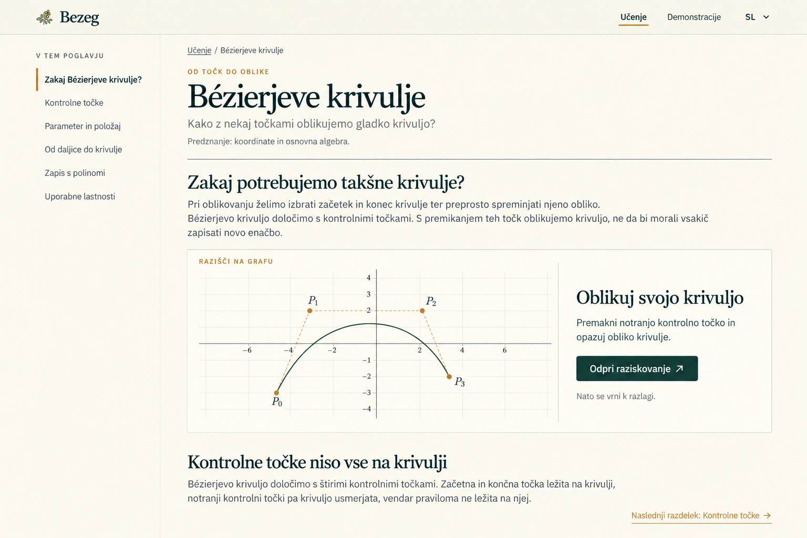
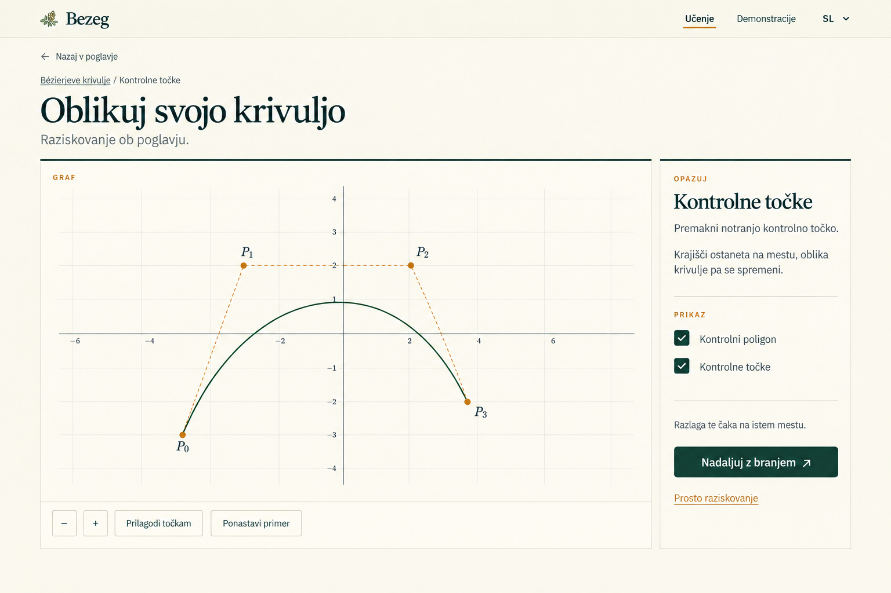

# Standalone learning through study chapters

Status: Bézier pilot released; implemented and published on 2026-10-20. [Implementation and hosted evidence](../reviews/standalone-learning/implementation.md) records the chapter and six activities. The [2026-10-24 owner policy](../guardrails.md#release-policy--owner-decision-2026-10-24) approves existing language, counts available drafts as released, and removes physical-device/projector/classroom gates, superseding conflicting criteria below. Concrete missing requirements and accessibility findings remain follow-ups. Expansion to another chapter remains separate work.

## Confirmed owner direction

- Bezeg should eventually be a place to learn its concepts, including their motivation and mathematical development, rather than requiring an accompanying course or textbook to supply those explanations.
- The eventual audience spans ages and levels. Assumed knowledge depends on the mathematical family and topic; there is no single beginner level for the entire app.
- Start with higher concepts, following the owner's interests and the existing advanced demonstrations. Building a complete elementary prerequisite sequence is not a condition for starting.
- Include reading, explanation, and graph exploration. Do not include practice exercises or assessment in this direction.
- Lead with intuition and precise mathematical statements. Include derivations or proofs only when their reasoning or intuition can be made readily apparent through the graph.
- Guided lessons remain useful, but placing all study material into their sequential frames would make revisiting and studying it cumbersome.
- Integrate chapters and Demonstrations through the same graph implementations, controls, and mathematical behavior. Keep every Demonstration independently discoverable and usable through the existing catalog.
- Use a readable chapter with activity previews, then expand the selected activity into a graph-centered workspace with a clear return to the reading section.

Standalone means self-contained within an explicitly stated prerequisite boundary. It does not mean every chapter starts from elementary mathematics. External sources may offer further reading, but should not supply a missing essential explanation inside that boundary.

## Problem

The current [Guided lesson](guided-lessons.md) is attached to one Demonstration and moves through bounded explanation, calculation, and observation frames. This suits directed graph exploration. A learner also needs a readable account of the question being answered, why the concept is useful, how its mathematics develops, and how it connects to other ideas. Those explanations must be easy to revisit without replaying a graph sequence.

Add a Study chapter that interleaves mathematical reading and focused graph activities, while also working as reference material. Learning and Demonstrations are two entry points into one educational product. This extends the earlier exclusion of curriculum navigation; it does not introduce a course platform. [ADR 0014](../adr/0014-study-chapters-share-demonstrations.md) records the shared ownership decision.

## Content structure and ownership

| Content | Responsibility |
| --- | --- |
| Family overview | Describe the area's questions, expected background, and suggested reading order. The reading order can differ from the demonstration catalog. |
| Study chapter | Develop one coherent learning goal through motivation, explanation, precise mathematics, author-worked examples, and graph activities. |
| Guided lesson | Lead a focused investigation of a prepared graph, retaining enough context to work when opened directly. |
| Demonstration | Provide open mathematical exploration, direct links, presentation, presets, and figure export. |

A chapter may use more than one Demonstration; a Demonstration may support more than one chapter. A Chapter activity identifies one existing Demonstration, an authored starting scene, a purpose, and the chapter section that interprets the observation. It does not define another graph implementation. Vocabulary lives in [GLOSSARY.md](../../GLOSSARY.md). Start with a small authored reading order and ordinary links, without a prerequisite engine or a fixed hierarchy of courses, units, and modules.

### Chapter contents

Each chapter should answer:

1. What question or problem motivates this concept, and why is solving it useful?
2. What knowledge is assumed? Which unfamiliar notation needs introducing here?
3. What is the mathematical idea, and how does the explanation lead to its definition or result?
4. What does a worked example illustrate?
5. What can the learner investigate on a graph, and how does the subsequent explanation interpret it?
6. What assumptions, limitations, and misleading intuitions matter?
7. How does this connect to earlier and later concepts?

Use sections appropriate to the subject rather than requiring this list as a rigid template. Author-worked examples are exposition, not exercises for the student to complete. Graph manipulation and observation remain part of learning; do not add answer submissions, quizzes, exercise sets, marks, or mastery checks.

The main account uses intuition and precise statements, including their assumptions. Include a derivation or proof only when its reasoning or intuition can be made readily apparent through the graph; do not promise a separate proof library or add symbolic derivations by default. For each proposed derivation, explain what the graph makes clear and what mathematical argument is still required. Distinguish visual evidence, intuition, definitions, and mathematical justification: a graph must not be presented as proof of a general claim. When a proof is omitted, state the result accurately and explain its meaning without claiming to have established it visually.

### Reading and revision

- Offer a suggested sequence for a first visit, with explanations before and after graph activities where useful.
- Keep headings, an accessible contents list, and stable section links so students can find a definition, example, or justification directly.
- Let students read without opening every activity. Follow-up explanations must remain intelligible with a stated expected observation.
- Use conceptual headings instead of a succession of generic Next screens.
- Treat optional deeper reading as a possible presentation choice, not a reason to hide assumptions or essential explanations.
- Do not lock later sections or infer understanding from clicks, reading position, or graph interaction.

### Different levels without an age mode

State prerequisites at family and chapter level. Higher-level chapters may assume calculus, linear algebra, or earlier curve concepts when appropriate. Introduce chapter-specific notation and link to available prerequisite explanations. Identify any required knowledge Bezeg does not yet teach rather than claiming complete prerequisite coverage.

Do not duplicate the same chapter for arbitrary age bands or promise every concept to every age group. Broader coverage can grow through additional entry points and prerequisite chapters as they become worthwhile.

## Visual direction and picture examples

The owner accepted these two views as the visual direction on 2026-10-16. Preserve Bezeg's elderflower identity, warm paper surfaces, forest-green headings, restrained gold accents, and existing mathematical graph styling. Use the pictures for composition and hierarchy; written requirements and the graph's mathematical state take precedence over generated text, plot geometry, axis labels, or exact spacing.

### A. Reading a chapter

- Keep the shared Bezeg header. Add visible Learning / Učenje and Demonstrations / Demonstracije destinations, alongside the existing language selector.
- On desktop, put chapter section navigation on the left and readable article content in the main column. The contents list identifies the current section without implying completion.
- Show title, purpose, prerequisite knowledge, motivation, explanations, formulas, author-worked examples, and section links. Use a comfortable line length, approximately 60–80 characters for ordinary prose; the reference's short copy is not the full chapter length.
- Place purposeful activity previews within the reading sequence. Each has a faithful static mathematical illustration, a concise invitation, and an explicit Open exploration / Odpri raziskovanje action. Its preview is not a live or draggable board.
- A Next section link is a reading convenience, not the only way to navigate. Readers can use the contents or stable section links and can read follow-up explanations without opening activities.

### B. Exploring the chapter activity

- Open the existing Demonstration workspace in chapter-activity context. Give the active graph most space; replace the long reading column and chapter contents with a short activity context.
- Show the chapter/section identity, activity purpose, relevant controls, Return to chapter / Nazaj v poglavje, and Continue reading / Nadaljuj z branjem. Both reading-return actions lead to the originating section; opening a graph does not mark that section complete or advance to another section automatically.
- Retain the shared graph and inspector implementation. Relevant controls may be emphasized or disclosed compactly for the activity, but normal editing, display, saving/export, Presentation mode, and demonstration switching stay reachable through the shared workspace. The picture's small control set is not permission to remove existing functionality.
- Free exploration / Prosto raziskovanje exits activity context and keeps the current scene in the ordinary Demonstration. Keep a Read about this link back to the explanation.
- Keep the graph interactive while the short prompt is visible. Do not open a blocking Guided lesson overlay automatically.

The supplied pictures cover reading and expanded activity states. The standalone workspace and catalog retain their existing layouts, with the related-reading links described below; there is no separate chapter-only graph design. Mobile layout and a real round trip must be verified during implementation, rather than inferred from these desktop images.

### Narrow screens, keyboard, and text size

Collapse chapter contents into a labeled, keyboard-operable disclosure or selector above the article. Stack preview content and actions with adequate touch targets. In the activity view, give the graph a useful viewport, place the short context and controls in the existing responsive workspace flow, and keep the return action easy to find. At 390px and 200% text size, prose and controls must wrap without document-level horizontal overflow; wide formulas may scroll within a labeled local region. Preserve visible focus, semantic headings, current-section identification beyond color alone, and reduced-motion behavior. Do not introduce required decorative transitions or auto-playing graph animation.

Every essential activity action must be possible without pointer dragging: use the shared coordinate editor, keyboard point movement, numeric parameter entry, or equivalent labeled controls as appropriate. Provide text that identifies the active control point/parameter and communicates the relevant value or mathematical change; graph color or animation alone is not sufficient. Keep updates useful without announcing every drag frame. Verify keyboard and assistive-technology access to the graph task itself, not only the chapter navigation and return buttons.

## Two entry points and independent discovery

| Entry | Result |
| --- | --- |
| Learning in the header | A learning index grouped by the existing mathematical families, initially containing the published Bézier chapter. Show actual available chapters without empty promised courses. |
| Chapter activity | The corresponding existing Demonstration with a prepared scene and chapter return context. |
| Demonstrations in the header | The existing searchable, family-filtered catalog. Every current graph remains reachable independently of chapter coverage. |
| Catalog preview/title/graph action or direct graph URL | Ordinary Demonstration entry, without automatically starting a chapter activity or Guided lesson. |
| Read about this in a supported Demonstration | The mapped chapter section, with a way back to the learner's current graph. |

Retain catalog filters, search, preview behavior, existing graph actions, available Guided lesson actions, and visit-scoped return-to-card behavior. Do not make opening a chapter a prerequisite for using a graph. The Demonstrations header destination continues to mean the catalog even during chapter activity; chapter return uses its own labeled action. Catalog provenance and chapter return context must coexist rather than overwrite each other.

Use a small static relationship map between chapters, sections, activities, and existing Demonstration IDs. For a demonstration with one published related chapter, Read about this opens its authored primary section. If several chapters apply, expose a short list of specifically titled related sections in reading order. A chapter-free demonstration simply has no chapter link; its existing lesson availability remains independent. Chapter titles do not rename demonstrations or change their family identities.

## Reading-to-graph implementation contract

Reading should have a comfortable document layout; exploration should give the graph the space and controls it needs. A permanently visible graph is not required while studying a long explanation. Preserve the graph-centered behavior of direct Demonstration visits.

An activity identifies its purpose, opens the intended prepared scene, and provides a clear return to the exact chapter section. Returning preserves reading position and chapter context. Activity entry, reset, exit, and return have the distinct meanings below.

Reuse typed, graph-owned actions and scene ownership from the existing lesson runtime where suitable. Do not simulate clicks or use stored Presets as hidden chapter scenes. Reuse does not mean that an entire existing Guided lesson is automatically the right activity at every chapter insertion point. Do not fork graph classes, evaluation algorithms, inspector controls, or export/preset behavior for Learning. Render at most one active board set for the selected Demonstration; static previews and reading pages mount no live mathematical boards.

### URLs and section identity

Add `/bezeg-2.0/learn` for the learning index and `/bezeg-2.0/learn/bezier-curves` for the pilot chapter. Section anchors use stable, untranslated IDs, including `motivation`, `control-points`, `parameter`, `interpolation`, `bernstein-form`, `geometric-properties`, `affine-transformations`, and `next-ideas`. Slovenian/English titles share the same identities. The chapter content outline remains in [the Bézier chapter document](bezier-study-chapter.md); these anchors name reading locations, not mandatory separate pages.

Activity URLs use the canonical Demonstration route with validated `chapter` and `activity` query parameters. For example, `/bezeg-2.0/bezier/curve?chapter=bezier-curves&activity=shape-control`. The activity registry owns its return section and starting scene; do not accept arbitrary return URLs, serialized user geometry, or graph commands from query strings. These URL details are the implementation contract specified here; no existing route is renamed. Query keys used by other features retain their existing meaning.

Direct chapter/section links and activity links must open and refresh on production GitHub Pages. An unknown chapter uses the app's accessible not-found behavior with links to Learning and Demonstrations. An unknown section falls back to the chapter start. An unknown, incomplete, or mismatched activity context falls back to the canonical standalone Demonstration with an actionable explanation, without applying scene actions. Use history replacement for this normalization and preserve unrelated query/hash values. Normal direct graph URLs retain their current behavior.

Hosting clarification, 2026-10-20: the Pages 404→index redirect replaces the document and discards `history.state`. A one-use, same-tab session-storage handoff may transport only bounded chapter/activity entry IDs, a reading section/invoking-activity ID, the related-reading Demonstration ID and the router's entry key/index across that immediate redirect. Match the exact original path/query/hash, expire stale handoffs, consume/remove them before use and validate authored identities again in the app. Never transport geometry, scene commands, pixel reading offsets, arbitrary history state, completion or Presets. If session storage is unavailable, reconstruct the authored activity and use its named chapter return without guessing a lost predecessor. This is redirect metadata transport, not persisted reading/activity memory or progress.

### Navigation and transient state

Keep reading locations, captured graph scenes, and activity snapshots in memory for the current app visit. Do not add local-storage progress, completion tracking, accounts, or Preset writes. History may carry validated IDs and reading anchors; graph snapshot objects belong to the app/graph owner rather than arbitrary URL payloads.

| Action | Required behavior |
| --- | --- |
| First Open exploration for an activity | Save the reading section, scroll position, and invoking focus target. Prepare the activity's authored scene on the existing graph only once it is ready. |
| Continue reading, Return to chapter, or browser Back after opening activity from the chapter | Pause/stop playback, capture the edited activity scene for this visit, dispose the departing graph, and restore the originating reading location. Focus the invoking activity action, using a visible section heading fallback if needed, without scrolling away from the restored location. Do not advance the chapter. |
| Reopen that activity or browser Forward during the same visit | Restore its edited snapshot, paused. Reset is explicit; reading a section again does not silently reapply the authored scene. |
| Reset example within activity | Replace only that activity's transient scene with its authored starting scene and stop playback. Leave chapter position and browser-local Presets unchanged. |
| Read about this from an ordinary Demonstration | Capture its current geometry, view, selection, and applicable graph state, pause playback, and open the related reading section. Offer Back to your graph, restoring this snapshot paused on return. Opening chapter activities must not overwrite that saved ordinary scene. |
| Free exploration from an activity | Capture the edited activity snapshot, keep the current scene, exit chapter-activity mode on the same canonical Demonstration route, and replace the activity URL context. It is an explicit adoption of this scene for ordinary exploration, not restoration of an older scene. The chapter remains reachable through related reading. |
| Switch to another Demonstration from activity | Capture the departing activity paused, open the chosen graph in ordinary context with its normal entry behavior, and clear the old activity query context. Retain an explicit chapter-return link for this visit; never apply the old scene actions to the new graph. |
| Start an existing Guided lesson during activity | Suspend the chapter activity and let the existing lesson session exclusively own scene changes. Preserve its Exit/Cancel checkpoint behavior. Finishing/exiting returns to the activity workspace paused; returning to reading first exits the lesson through its normal cleanup. Do not run overlapping scene owners. |
| Refresh or open an activity URL in a new tab | Reconstruct the valid authored activity and return section, paused. Transient edits and pixel reading offsets are not persisted. Show a concise notice that the activity restarted when refresh lost a previously active snapshot. |
| Change language | Retain stable section/activity identity, graph geometry, view, and reading context. Re-typeset formulas and restore position by section-relative anchor if text height changes. |

Different activities using the same Demonstration have independent visit-scoped snapshots. Capture/restore includes the selected example, control points or parameters, construction visibility, view, selection, and relevant auxiliary state; animations always resume paused. Use a section-relative reading anchor with pixel offset where available, clamp after content reflow, and focus a meaningful fallback when a stored target no longer exists.

Honor actual browser history. When an activity's recorded immediately preceding entry is the matching chapter reading location, both explicit reading-return actions traverse back to that existing entry; Forward reopens the activity and restores its edited snapshot paused. Only traverse when that immediate predecessor is known and matches validated app-owned entry IDs. Otherwise, including a fresh activity deep link or a return retained after switching graphs, push one chapter-section entry; Back then returns to the actual preceding graph/activity entry and Forward returns to reading. Do not guess an offset through unrelated history. A fresh activity deep link does not fabricate a previous chapter history entry or intercept browser Back to force a chapter visit. Repeated navigation to an already-current reading location uses replacement rather than a duplicate push. If the ordinary-graph source snapshot is unavailable after reload, related-reading return opens the canonical graph's normal starting state with a clear notice rather than promising recovery of lost edits.

For restart messaging, retain only a validated app-owned history-state marker saying this entry's chapter/activity/Demonstration tuple was previously started, plus its navigation entry identity. It contains no scene data, understanding/completion state, or persistent progress. If that matching marker survives reload but the current document has no activity snapshot, show the restart notice and prepare the authored scene. A fresh/new-tab URL without the marker starts normally without claiming that edits were lost. Invalid or mismatched markers are ignored; ordinary in-visit snapshot restoration does not show the restart notice.

If checkpoint capture, scene preparation, capability validation, or restoration fails, stop playback, roll back to the last valid scene when possible, and show a Retry/Return to chapter error. If rollback is impossible, dispose the failed owner and offer a clean standalone demonstration. Never silently continue with a partially applied scene or save it into a Preset. Navigation during export or scene replacement must use the shared workspace's existing availability/cleanup rules.

### Pilot activities and graph consistency

The first release is one complete Bézier chapter, backed by the existing `bezier`, `decasteljau`, `bernstein`, and `affine` Demonstrations. Reuse their graph-owned capabilities; no new curve family, construction algorithm, arbitrary scene-language engine, or live linked dual-board Bernstein/curve visualization is required.

| Activity ID | Demonstration | Starting intent | Return section |
| --- | --- | --- | --- |
| `shape-control` | `bezier` | Default cubic controls with control points and polygon visible; compare edits to interior controls. | `control-points` |
| `curve-parameter` | `decasteljau` | Its explicitly labeled degree-four example with full curve/construction visible, paused at the midpoint parameter. | `parameter` |
| `repeated-interpolation` | `decasteljau` | The same labeled degree-four example and midpoint construction, interpreted as repeated interpolation; independent activity state. | `interpolation` |
| `blending-coefficients` | `bernstein` | Degree two for the quadratic explanation; ordinary basis view initially, with the stacked-area control available for inspecting the sum. | `bernstein-form` |
| `geometric-bounds` | `bezier` | The authored cubic with control polygon and convex hull visible. | `geometric-properties` |
| `transform-shape` | `affine` | Its labeled default cubic and supported whole-shape transformations. | `affine-transformations` |

The opening motivation may preview and open `shape-control`; its named return is the following control-points explanation. Each actual invocation additionally remembers its reading position for the in-app round trip. A shared activity URL without visit context uses the registry's named return section.

For direct related-reading entry, the pilot's primary sections are `control-points` for `bezier`, `interpolation` for `decasteljau`, `bernstein-form` for `bernstein`, and `affine-transformations` for `affine`. Do not automatically attach the new chapter to every other curve demonstration merely because it belongs to the same family.

Use the actual supported route defaults, visibly identifying changed examples. In particular, ordinary Bézier and De Casteljau defaults are cubic and quartic respectively. The quadratic derivation is an explanatory illustration; it does not imply that the current De Casteljau graph silently became quadratic. A later common-scene capability can be scoped independently. A moving parameter or whole-curve toggle needed by an activity must be exposed through a narrow typed graph-owned action if not yet available; it must not be implemented as simulated UI clicks. See the [capability audit](bezier-study-chapter-source-notes.md).

## Content ownership and existing lessons

Chapters own the fuller conceptual development. Guided lessons own concise instructions and observations for their graph investigation, including enough local explanation to remain usable directly. Link activities to the relevant chapter sections for depth. Avoid independently maintained copies of long mathematical explanations.

Audit existing content before deciding what to reuse, move, rewrite, or retain. Keep current lessons available while proving the new format. Do not turn every lesson frame into a chapter section mechanically, or expand every catalog entry into a chapter regardless of educational fit.

Keep content static and source-backed, Slovenian first with English counterparts. Sources, mathematical review, notation, examples, and graph claims require the same care as existing lesson content. Publishing source citations does not replace explaining the topic inside Bezeg.

## Bounded pilot and acceptance criteria

The owner selected Bézier curves on 2026-10-16 and supplied their thesis for the motivation. The [first chapter outline](bezier-study-chapter.md) develops editable shapes through repeated interpolation to the Bézier formula and its design guarantees. The product/visual direction is accepted; final content, source/translation review, and interaction evidence remain release gates. This establishes an entry point into the curve families without requiring a complete elementary sequence first.

The picture examples establish the selected presentation direction. Next write and review the complete learner-facing content, then exercise the reading/graph round trip in a bounded implementation or interaction prototype. Do not add executable task files under this documentation-only request.

The pilot is successful when:

- Its intended reader, prerequisite boundary, and learning goal are explicit.
- It supplies motivation and essential explanation within that boundary, including a worked example and relevant limitations, without requiring external reading.
- At least one sequence goes from explanation to a purposeful graph investigation and back to mathematical explanation.
- A returning reader can navigate directly to a definition or worked example without replaying activities.
- Opening and returning from an activity preserves chapter context and has specified, verified graph-state behavior.
- The chapter and activity agree mathematically; visual observations are distinguished from justification.
- Direct Demonstration and Guided lesson entry remain useful.
- No practice or assessment feature is introduced.
- Subject-matter and language review, desktop/narrow-screen reading, projection where relevant, and keyboard/touch activity navigation are recorded before calling it ready.
- Learning and Demonstrations are both directly discoverable from the shared header; catalog filters/search and standalone graph entry remain intact.
- Activity and standalone entry use the same graph/inspector implementation, and graph functionality remains reachable in both contexts.
- Direct links, refresh, Back/Forward, reset, free exploration, graph switching, language changes, and Guided lesson ownership obey the navigation table above.
- Chapter-free Demonstrations remain available, and related-reading links appear only for published chapter content.

Content review and prototype observations must identify what is missing before extending the structure to other families. Do not use reading completion as evidence that a student understands the mathematics.

## Verification required for implementation

| Concern | Required evidence |
| --- | --- |
| Content and mathematics | Owner/subject-matter review of motivation, prerequisites, notation, example changes, geometric claims, and graph-friendly reasoning; independently check worked examples against real authored scenes. |
| Static relationships | Validate chapter/section/activity IDs, Demonstration references, related-reading targets, primary section selection, and unsupported graph actions. |
| State and history | Focused tests for every navigation-table row, independent activity snapshots, unchanged Preset storage, capture/restore failure and rollback, invalid navigation state, and unknown/mismatched URL context. |
| Graph ownership | Real-board checks for repeated activity entry/return, graph switching, reset, lesson entry/exit, animation cleanup, exports, and geometry/control agreement; no duplicate boards, listeners, or active owners. |
| Discovery and study | Browse through Learning, jump to a definition, open an activity, edit and return, revisit it, then find the same graph directly through the existing filtered/searched catalog; follow Read about this and restore the ordinary scene. |
| Presentation/accessibility | Desktop reading/activity views, 390px layouts, 200% text, keyboard focus restoration and controls, non-drag and assistive-technology access to each essential graph task and its relevant changes, touch-sized targets, reduced motion, formula overflow, and graph Presentation mode. Record physical touch/projector coverage or its absence. |
| Languages | Slovenian and English content/labels in lockstep; live switching retains activity/section state. Run `npx tsc --noEmit --pretty false` and production build after localization implementation. |
| Hosting and publication | Production build asset loading; direct learn/chapter/section/activity links, refresh, query/hash preservation, invalid paths, and existing graph routes under the Pages project base. |

Implementation crosses the shared shell, routing, and graph lifecycle: use the smoke-tester skill and full [browser checklist](../smoke-tests.md), with focused checks for the new chapter round trips and every pilot activity. Run the existing unit suite, TypeScript, and production build. Keep lesson math-notation tests and guided-lesson smoke rows intact. This specification/image-only commit requires document, asset, and whitespace checks; it does not establish runtime, classroom, or hosted feature acceptance.

## Compatibility and user impact

Implementation adds the Learning index, chapter routes, and optional activity context on existing graph URLs. Existing direct graph paths, catalog links, family/graph IDs, Guided lessons, saved Presets, file formats, and exports remain valid. No storage migration or route alias is required. The shared header gains a Learning destination; the catalog remains the direct graph index. New reading/context memory is visit-scoped and is lost on a full reload; valid activity links reconstruct the authored starting example rather than a learner's edits.

## Staging and remaining review

1. Finish and review the Bézier chapter's Slovenian content and English counterpart against its stated prerequisite boundary and thesis source map.
2. Validate the pilot action mappings and implement only narrowly missing graph-owned capabilities, with relevant mathematical checks.
3. Implement the shared reading/activity navigation and transient state contract without duplicating graph implementations.
4. Verify first-time reading, revision access, independent graph discovery, and all specified round trips on the production build.
5. Release one reviewed chapter; expand through coherent topics and family reading orders afterward.

Remaining review: final learner-facing prose, precise activity prompts, terminology translations, and measured layout/interaction acceptance. This spec selects chapter/activity composition, route identity, visit-scoped state, and discovery behavior. Persistent reading positions and broader family content are future scope, separate from understanding or completion tracking.

## Reference asset provenance

`assets/standalone-learning/chapter-reading.png` and `chapter-activity.png` are the two built-in ImageGen UI mockups shown in this chat and accepted as the design direction. They were generated using Bezeg's existing desktop workspace screenshot as a style reference, then copied unmodified into this repository for this specification. These are design references, not production assets or screenshots of implemented functionality. Do not load them into the app bundle or derive exact mathematical geometry from them.

## Constraints and exclusions

Retain static client-only hosting, no accounts or server database, existing Preset ownership, mathematical correctness, and explicit graph lifecycle management. No authoring CMS, adaptive teaching, prerequisite enforcement, practice/exercise system, grading, learner analytics, certificates, cloud progress, or full-catalog content promise. The eventual breadth of audiences does not create a requirement to implement all prerequisite material before an advanced pilot.
